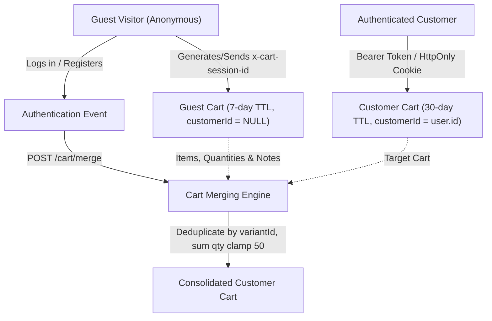
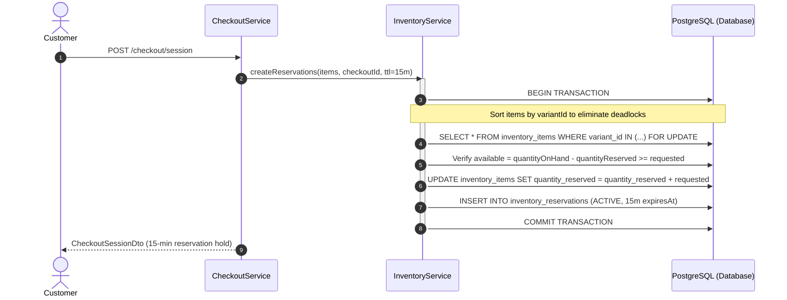
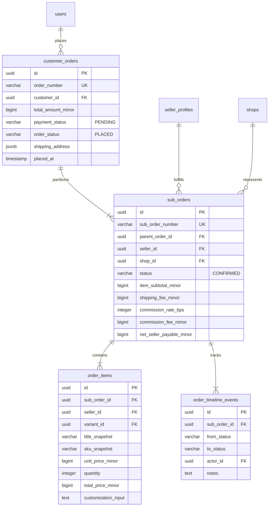

# CART, CHECKOUT & ORDER CREATION ARCHITECTURE

## Handcrafted Multi-Vendor Marketplace Platform (Gate G08)

---

## 1. Domain Objective & Governance Boundaries

Gate G08 establishes the authoritative shopping cart, customer delivery address management, server-side pricing engine, atomic stock reservation hold, and multi-vendor order partitioning foundation for the handcrafted marketplace.

The platform directly bridges independent artisans (selling pottery, paintings, woodcraft, jewellery, textiles, and customised gifts) with retail customers.

### 1.1 Strict Gate Scope Invariants

- **In Scope (Gate G08):**
  - Cart persistence for both anonymous guest visitors (`sessionId`) and authenticated customers (`customerId`).
  - Strict quantity limits (minimum 1, maximum 50 per item), cart deduplication, and guest-to-customer cart merging upon login.
  - Saved customer delivery address management with Indian 6-digit PIN code (`/^[1-9][0-9]{5}$/`) and 10-digit mobile number validation.
  - Server-authoritative integer minor units pricing engine (paise in INR). Zero floating-point arithmetic.
  - Independent artisan shipping fee logic (₹50.00 / 5000 paise per studio; free shipping on artisan subtotal $\ge$ ₹1,000.00 / 100000 paise).
  - Platform/seller coupon discount engine supporting basis points (`PERCENTAGE`) and flat (`FIXED_AMOUNT`) deductions.
  - Concurrency-safe atomic inventory reservation holds with 15-minute TTL utilizing PostgreSQL row-level locks (`SELECT ... FOR UPDATE`) sorted by variant ID to eliminate deadlocks.
  - Transactional order creation splitting checkout sessions into parent `customer_orders`, artisan-partitioned `sub_orders`, immutable `order_items` snapshots, and `order_timeline_events`.
  - Enforced order status invariants: orders strictly remain in `paymentStatus: 'PENDING'` and `orderStatus: 'PLACED'`.
  - Idempotent order submission via `idempotency-key` header verification.
  - Storefront UI in `apps/storefront` (`/cart`, `/checkout`, `/checkout/success`, header cart badge counter, PDP "Add to Cart" enablement).

- **Strictly Out of Scope (Deferred Gates):**
  - **Payment Gateways & Capture:** Razorpay/Stripe webhooks, signature verification, payment intents, and transitions to `PAID` are strictly deferred to **Gate G09**.
  - **Financial Ledgers & Artisan Payouts:** Double-entry journal entries, escrow holding, commission transfers, and bank payouts are strictly deferred to **Gate G10**.
  - **Logistics & Carrier Booking:** External courier APIs, shipping label generation, and tracking webhooks are strictly deferred to **Gate G11**.

---

## 2. Cart Lifecycle & Session Resolution

### 2.1 Cart Identification

1. **Guest Sessions:** Resolved via `x-cart-session-id` HTTP request header or `cart_session_id` cookie. Provisioned with a 7-day expiration window.
2. **Authenticated Customers:** Resolved via authenticated JWT token (`req.user.id`). Provisioned with a 30-day expiration window.
3. **Cart Merge Protocol (`POST /cart/merge`):**
   - Transacted atomically upon login.
   - For every line item in the guest session, if the item exists in the customer's cart, quantities are summed and clamped to 50.
   - If the item does not exist, it is reparented to the customer cart.
   - The guest cart is purged to prevent orphan session leaks.

---

## 3. Server-Authoritative Pricing Engine (Paise)

Floating-point numbers are prohibited in all monetary calculations. All figures are maintained as integer minor units (`bigint`/`number` paise in INR):

$$\text{Line Total} = \text{Unit Price Minor} \times \text{Quantity}$$

$$\text{Artisan Shipping Fee} = \begin{cases} 0 & \text{if } \text{Seller Item Subtotal} \ge 100{,}000 \text{ paise (₹1,000)} \\ 5{,}000 \text{ paise (₹50)} & \text{otherwise} \end{cases}$$

$$\text{Platform Commission} = \left\lfloor \frac{\text{Seller Item Subtotal} \times \text{Commission Rate Bps}}{10{,}000} \right\rfloor$$

$$\text{Net Seller Payable} = \text{Seller Item Subtotal} + \text{Shipping Fee} - \text{Commission Fee} - \text{Seller Discount}$$

$$\text{Grand Total} = \sum \text{Subtotals} + \sum \text{Shipping Fees} + \sum \text{Taxes} - \text{Discount Total}$$

Every checkout quote and session persists an immutable record in `pricing_snapshots` containing the full calculated JSON breakdown and minor integer amounts.

---

## 4. Atomic Inventory Reservation & Concurrency Safety

To prevent race conditions, overbooking, and concurrent inventory exhaustion on high-demand handcrafted creations, inventory holds are locked atomically at the database level:

1. **Deadlock Elimination:** Variant IDs are sorted alphabetically before acquiring row-level locks, ensuring consistent lock acquisition ordering across all concurrent client transactions.
2. **Reservation TTL:** Active holds expire automatically after 15 minutes unless committed or explicitly released.
3. **Commit on Confirmation:** Upon successful order placement, `commitReservations` atomically decrements `quantity_on_hand` and `quantity_reserved`, records a `SALE_COMMITTED` stock adjustment audit entry, and marks reservations as `COMMITTED`.

---

## 5. Multi-Artisan Order Partitioning Model

Because an artisan marketplace aggregates goods from disparate workshops with separate fulfillment lifecycles, checkout creates a 2-tier order hierarchy:

### 5.1 Referential Isolation Guarantee

- The composite foreign key constraint `fk_order_items_sub_order_seller` enforces that an `order_items` record cannot be associated with a `sub_orders` partition belonging to a different artisan.
- Each artisan workshop can view, confirm, fabricate, pack, and ship their sub-orders autonomously without access to customer purchases from other artisans.

---

## 6. Order Placement Invariants & Idempotency

1. **Idempotency Protection:** The checkout confirmation endpoint accepts an `idempotency-key` HTTP header. Duplicate requests for the same checkout session ID are detected via timeline audit notes and rejected with `409 Conflict`.
2. **Order Payment Invariant:** `payment_status` is strictly seeded as `'PENDING'`. No test mocks, fake auto-pay callbacks, or premature transitions to `PAID` are permitted in Gate G08.
3. **Order Status Invariant:** `order_status` is initialized as `'PLACED'`. Sub-orders are seeded as `'CONFIRMED'`.
