# Database Schema Specification: Handcrafted Multi-Vendor Marketplace

**Document Version:** 1.0.0  
**Effective Date:** Gate G03 Baseline  
**ORM / Engine:** PostgreSQL 16+ via Drizzle ORM (`@repo/db`)  
**Status:** Implemented & Verified

---

## 1. Architecture Overview

The Handcrafted Multi-Vendor Marketplace persistence architecture is implemented on **PostgreSQL 16** with **Drizzle ORM**, structured inside the dedicated monorepo workspace package [`@repo/db`](file:///Users/subhamdas/Documents/PROJECTS/ecommerce/packages/db).

### Core Database Invariants

1. **Integer Minor Currency Units:** Monetary values are strictly stored as `bigint` (e.g., `amount_minor`), representing minor currency units (paise/cents) to eliminate floating-point rounding errors.
2. **UTC Timestamp Standards:** All temporal attributes utilize PostgreSQL `timestamp with time zone` (`timestamptz`) defaulting to `NOW()`. All application interactions strictly preserve UTC timestamps.
3. **Universally Unique Primary Keys:** Tables utilize UUIDv4/UUIDv7 primary keys generated via PostgreSQL's native `gen_random_uuid()` default.
4. **Relational Multi-Vendor Integrity:** Autonomous artisan sub-orders and their line items are bounded by composite foreign keys (`sub_orders(id, seller_id)` -> `order_items(sub_order_id, seller_id)`), preventing cross-tenant item assignment at the engine level.
5. **Double-Entry Financial Immutability:** Ledger postings are append-only. Balanced journal transactions enforce $\sum \text{Debits} == \sum \text{Credits}$ within single atomic transactions.

---

## 2. Entity-Relationship Diagram (ERD)

```mermaid
erDiagram
    USERS ||--o{ USER_SESSIONS : maintains
    USERS ||--o{ USER_ROLES : holds
    ROLES ||--o{ USER_ROLES : assigned_to
    ROLES ||--|{ ROLE_PERMISSIONS : contains
    PERMISSIONS ||--|{ ROLE_PERMISSIONS : mapped_to
    USERS ||--o| SELLER_PROFILES : owns
    SELLER_PROFILES ||--|| SHOPS : operates
    SELLER_PROFILES ||--o{ SELLER_DOCUMENTS : submits
    SELLER_PROFILES ||--o{ PICKUP_ADDRESSES : dispatches_from
    SELLER_PROFILES ||--o{ PAYOUT_ACCOUNTS : links
    SELLER_PROFILES ||--o| SELLER_BALANCES : tracks

    CATEGORIES ||--o{ CATEGORIES : "parent_to (tree)"
    CATEGORIES ||--o{ PRODUCTS : categorizes
    SELLER_PROFILES ||--o{ PRODUCTS : lists
    PRODUCTS ||--|{ PRODUCT_VARIANTS : has_sku
    PRODUCTS ||--o{ PRODUCT_MEDIA : showcases
    PRODUCTS ||--o{ MODERATION_RECORDS : audited_by
    PRODUCT_VARIANTS ||--|| INVENTORY_ITEMS : tracks_stock
    PRODUCT_VARIANTS ||--o{ INVENTORY_RESERVATIONS : holds_stock
    PRODUCT_VARIANTS ||--o{ STOCK_ADJUSTMENTS : auditable_delta

    USERS ||--o{ CARTS : creates
    CARTS ||--o{ CART_ITEMS : contains
    PRODUCT_VARIANTS ||--o{ CART_ITEMS : selected_in
    SELLER_PROFILES ||--o{ COUPONS : issues

    USERS ||--o{ CUSTOMER_ORDERS : places
    CUSTOMER_ORDERS ||--|{ SUB_ORDERS : "splits_into (per seller)"
    SUB_ORDERS ||--|{ ORDER_ITEMS : fulfills
    PRODUCT_VARIANTS ||--o{ ORDER_ITEMS : snapshot_of
    SUB_ORDERS ||--o{ ORDER_TIMELINE_EVENTS : lifecycle_events
    SUB_ORDERS ||--o| SHIPMENTS : books
    SHIPMENTS ||--o{ SHIPMENT_MILESTONES : tracks
    SUB_ORDERS ||--o{ RETURN_REQUESTS : handles

    CUSTOMER_ORDERS ||--|{ PAYMENT_ATTEMPTS : captures
    PAYMENT_ATTEMPTS ||--|{ PAYMENT_ALLOCATIONS : splits
    SUB_ORDERS ||--|| PAYMENT_ALLOCATIONS : settled_by
    PAYMENT_ATTEMPTS ||--o{ REFUND_REQUESTS : refunds

    LEDGER_ACCOUNTS ||--o{ LEDGER_ENTRIES : debits_credits
    SELLER_PROFILES ||--o{ LEDGER_ENTRIES : accrues
    SUB_ORDERS ||--o{ LEDGER_ENTRIES : origin_order
    PAYOUT_BATCHES ||--|{ PAYOUT_TRANSACTIONS : groups
    PAYOUT_TRANSACTIONS ||--|| PAYOUT_ACCOUNTS : transfers_to
    SELLER_PROFILES ||--o{ PAYOUT_TRANSACTIONS : pays

    USERS ||--o{ REVIEWS : writes
    ORDER_ITEMS ||--o| REVIEWS : verified_purchase
    USERS ||--o{ SUPPORT_TICKETS : opens
    SUB_ORDERS ||--o{ DISPUTES : escalates
    USERS ||--o{ AUDIT_LOGS : records_action
```

---

## 3. Database Inventory: 44 Tables by Bounded Domain

| Domain                     | Table Name               | Purpose                              | Primary Key                | Key Constraints                                       |
| :------------------------- | :----------------------- | :----------------------------------- | :------------------------- | :---------------------------------------------------- |
| **Identity & Access**      | `users`                  | Customer & artisan accounts          | `id` (UUID)                | Unique `email`, email format CHECK                    |
|                            | `user_sessions`          | Refresh session tokens & IP audit    | `id` (UUID)                | Unique `refresh_token_hash`, FK `users` CASCADE       |
|                            | `roles`                  | System roles (RBAC)                  | `id` (UUID)                | Unique `name`                                         |
|                            | `permissions`            | Granular permission primitives       | `id` (UUID)                | Unique `code`                                         |
|                            | `role_permissions`       | Role-permission join table           | `(role_id, permission_id)` | Composite PK                                          |
|                            | `user_roles`             | Role grants (global & seller-scoped) | `id` (UUID)                | Unique `(user_id, role_id, COALESCE(seller_id))`      |
|                            | `audit_logs`             | Append-only security audit trail     | `id` (UUID)                | FK `users` SET NULL, Indexed timestamps               |
| **Seller & Shop**          | `seller_profiles`        | Artisan business legal identities    | `id` (UUID)                | Unique `user_id`, Commission & tier CHECKs            |
|                            | `shops`                  | Public artisan storefronts           | `id` (UUID)                | Unique `seller_id`, Unique `slug`, Rating CHECK       |
|                            | `seller_documents`       | Private KYC document records         | `id` (UUID)                | FK `seller_profiles`, File size > 0 CHECK             |
|                            | `pickup_addresses`       | Dispatch origin locations            | `id` (UUID)                | FK `seller_profiles` CASCADE                          |
|                            | `payout_accounts`        | Bank & Stripe Connect references     | `id` (UUID)                | FK `seller_profiles` CASCADE                          |
| **Catalog & Media**        | `categories`             | Hierarchical category taxonomy       | `id` (UUID)                | Unique `slug`, Self-referential tree FK               |
|                            | `products`               | Artisan handcrafted listings         | `id` (UUID)                | Unique `slug`, Base price >= 0 CHECK                  |
|                            | `product_variants`       | Purchasable SKU items                | `id` (UUID)                | Unique `sku`, Price >= 0, Dimensions > 0 CHECKs       |
|                            | `product_media`          | Image and video CDN assets           | `id` (UUID)                | FK `products` CASCADE, Display order index            |
|                            | `moderation_records`     | Product review decisions             | `id` (UUID)                | FK `products` CASCADE, FK `users` (moderator)         |
| **Inventory & Locking**    | `inventory_items`        | On-hand physical stock per SKU       | `id` (UUID)                | Unique `variant_id`, Reserved <= OnHand CHECK         |
|                            | `inventory_reservations` | 15-minute checkout holding locks     | `id` (UUID)                | Quantity > 0 CHECK, Status + Expires index            |
|                            | `stock_adjustments`      | Auditable stock change ledger        | `id` (UUID)                | FK `product_variants` CASCADE, Reason enum            |
| **Shopping & Pricing**     | `carts`                  | Customer & guest containers          | `id` (UUID)                | FK `users` CASCADE, Expiry index                      |
|                            | `cart_items`             | Line items with customization        | `id` (UUID)                | Unique `(cart_id, variant_id)`, Quantity > 0          |
|                            | `coupons`                | Promotions & discounts               | `id` (UUID)                | Unique `code`, Discount > 0, Limit CHECKs             |
|                            | `pricing_snapshots`      | Checkout price calculations          | `id` (UUID)                | Unique `checkout_id`, Non-negative amounts            |
| **Orders & Fulfillment**   | `customer_orders`        | Parent checkout orders               | `id` (UUID)                | Unique `order_number`, Total >= 0 CHECK               |
|                            | `sub_orders`             | Autonomous artisan fulfillments      | `id` (UUID)                | Unique `sub_order_number`, Unique `(id, seller_id)`   |
|                            | `order_items`            | Purchased items with price freeze    | `id` (UUID)                | Composite FK `(sub_order_id, seller_id)`, Price CHECK |
|                            | `order_timeline_events`  | Sub-order state change events        | `id` (UUID)                | FK `sub_orders` CASCADE, Append-only                  |
| **Payments & Allocations** | `payment_attempts`       | External gateway payment intents     | `id` (UUID)                | Unique `provider_intent_id`, Unique `idempotency_key` |
|                            | `payment_allocations`    | Parent capture split to sub-orders   | `id` (UUID)                | FK `payment_attempts`, FK `sub_orders`                |
|                            | `payment_webhook_events` | Gateway idempotency deduplication    | `id` (UUID)                | Unique `(provider, event_id)`                         |
|                            | `refund_requests`        | Customer refund claims               | `id` (UUID)                | Unique `refund_number`, Amount > 0 CHECK              |
| **Ledger & Settlement**    | `ledger_accounts`        | Chart of accounts                    | `id` (UUID)                | Unique `code`, Type enum                              |
|                            | `ledger_entries`         | Immutable double-entry postings      | `id` (UUID)                | Batch ID index, Amount > 0 CHECK                      |
|                            | `seller_balances`        | Materialized balance projections     | `id` (UUID)                | Unique `seller_id`, Non-negative balance CHECKs       |
|                            | `payout_batches`         | Grouped payout disbursements         | `id` (UUID)                | Unique `batch_number`, Dual-approval FKs              |
|                            | `payout_transactions`    | Individual seller disbursements      | `id` (UUID)                | FK `payout_batches`, FK `payout_accounts`             |
| **Shipping & Logistics**   | `shipments`              | Waybills and tracking records        | `id` (UUID)                | Unique `sub_order_id`, Dimensions > 0 CHECKs          |
|                            | `shipment_milestones`    | Waypoint tracking events             | `id` (UUID)                | FK `shipments` CASCADE, Timestamp index               |
|                            | `return_requests`        | Defective/unwanted return claims     | `id` (UUID)                | FK `sub_orders`, FK `users` (customer)                |
| **Support & Disputes**     | `reviews`                | Verified purchase feedback           | `id` (UUID)                | Unique `order_item_id`, Rating 1..5 CHECK             |
|                            | `support_tickets`        | Customer/seller support inquiries    | `id` (UUID)                | Unique `ticket_number`, Priority & category enums     |
|                            | `disputes`               | Formal artisan disputes              | `id` (UUID)                | Unique `dispute_number`, Claimed > 0 CHECK            |
| **Event Outbox**           | `outbox_events`          | Transactional CloudEvents outbox     | `id` (UUID)                | Status + Timestamp index for polling/CDC              |

---

## 4. PostgreSQL Enums

The database defines 32 strongly-typed PostgreSQL enums:

1. `user_status`: `PENDING_VERIFICATION`, `ACTIVE`, `SUSPENDED`, `DEACTIVATED`
2. `seller_business_type`: `INDIVIDUAL`, `SOLE_PROPRIETORSHIP`, `REGISTERED_COMPANY`
3. `seller_verification_status`: `DRAFT`, `PENDING_REVIEW`, `VERIFIED`, `REJECTED`, `SUSPENDED`
4. `seller_document_type`: `GOVERNMENT_ID`, `TAX_CERTIFICATE`, `BANK_PROOF`, `ARTISAN_CERTIFICATE`
5. `document_verification_status`: `PENDING`, `VERIFIED`, `REJECTED`
6. `product_type`: `READY_TO_SHIP`, `ONE_OF_A_KIND`, `MADE_TO_ORDER`, `PERSONALIZED`
7. `product_moderation_status`: `DRAFT`, `PENDING_REVIEW`, `APPROVED`, `REJECTED`, `SUSPENDED`
8. `media_type`: `IMAGE`, `VIDEO`
9. `reservation_status`: `ACTIVE`, `COMMITTED`, `RELEASED`, `EXPIRED`
10. `stock_adjustment_reason`: `MANUAL_CORRECTION`, `RECEIPT`, `BREAKAGE`, `SALE_COMMITTED`, `RETURN_RESTOCK`, `AUDIT_DISCREPANCY`
11. `discount_type`: `PERCENTAGE`, `FIXED_AMOUNT`
12. `coupon_funded_by`: `PLATFORM`, `SELLER`
13. `order_payment_status`: `PENDING`, `AUTHORIZED`, `PAID`, `FAILED`, `REFUNDED`
14. `order_status`: `PLACED`, `PROCESSING`, `PARTIALLY_SHIPPED`, `COMPLETED`, `CANCELLED`
15. `sub_order_status`: `CONFIRMED`, `IN_PRODUCTION`, `READY_FOR_PICKUP`, `SHIPPED`, `DELIVERED`, `COMPLETED`, `CANCELLED`, `RETURNED`
16. `payment_provider`: `STRIPE`, `RAZORPAY`, `MOCK_PROVIDER`
17. `payment_attempt_status`: `INITIATED`, `PROCESSING`, `SUCCEEDED`, `FAILED`, `CANCELLED`
18. `refund_reason`: `CUSTOMER_CANCELLATION`, `DEFECTIVE_ITEM`, `ITEM_NOT_RECEIVED`, `SELLER_UNFULFILLED`, `DISPUTE_RESOLUTION`
19. `refund_status`: `REQUESTED`, `APPROVED`, `PROCESSING`, `COMPLETED`, `REJECTED`
20. `ledger_account_type`: `ASSET`, `LIABILITY`, `EQUITY`, `REVENUE`, `EXPENSE`
21. `ledger_entry_type`: `DEBIT`, `CREDIT`
22. `payout_batch_status`: `PENDING`, `SUBMITTED`, `PROCESSING`, `COMPLETED`, `FAILED`, `PARTIALLY_SETTLED`
23. `payout_transaction_status`: `PENDING`, `SUBMITTED`, `SUCCEEDED`, `FAILED`
24. `shipment_status`: `LABEL_CREATED`, `PICKUP_SCHEDULED`, `IN_TRANSIT`, `OUT_FOR_DELIVERY`, `DELIVERED`, `RTO_INITIATED`, `RTO_DELIVERED`
25. `return_status`: `REQUESTED`, `APPROVED`, `ITEM_SHIPPED`, `ITEM_RECEIVED`, `REFUNDED`, `REJECTED`
26. `review_moderation_status`: `PENDING`, `APPROVED`, `REJECTED`
27. `support_category`: `ORDER_ISSUE`, `PAYMENT_DISPUTE`, `SHIPPING_DELAY`, `SELLER_VERIFICATION`, `GENERAL_INQUIRY`
28. `ticket_status`: `OPEN`, `IN_PROGRESS`, `WAITING_FOR_USER`, `RESOLVED`, `CLOSED`
29. `ticket_priority`: `LOW`, `MEDIUM`, `HIGH`, `URGENT`
30. `dispute_reason`: `DAMAGED_HANDMADE_GOOD`, `NOT_AS_DESCRIBED`, `NOT_DELIVERED`, `UNAUTHORIZED_RETURN_REJECTION`
31. `dispute_status`: `OPEN`, `UNDER_REVIEW`, `RESOLVED`, `CLOSED`
32. `dispute_resolution`: `FULL_REFUND`, `PARTIAL_REFUND`, `REJECTED`, `SELLER_FAVORED`

---

## 5. Deletion & Retention Behavior

1. **Transactional Data is Append-Only:** `ledger_entries`, `audit_logs`, `order_timeline_events`, and `shipment_milestones` reject hard deletions.
2. **Cascading Deletions on Ephemeral Data:** Carts, cart items, user sessions, and uncommitted product drafts cascade when parent entities are removed.
3. **Restrictive Referential Integrity:** Customer orders, sub-orders, product variants, and completed transactions enforce `ON DELETE RESTRICT` against referenced users, products, and accounts to preserve financial and operational audit trails.
