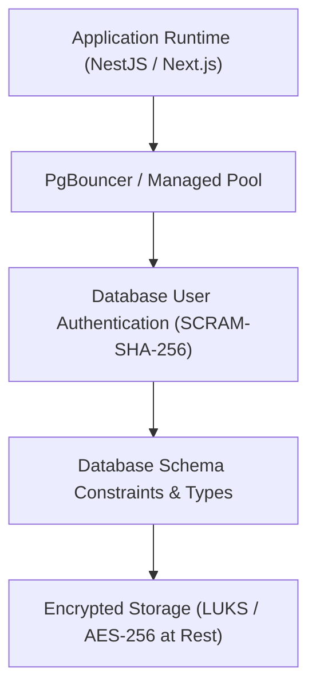

# Database Security & Access Governance

**Document Version:** 1.0.0  
**Effective Date:** Gate G03 Baseline  
**Status:** Security Architecture Policy

---

## 1. Threat Model & Defense-in-Depth

The marketplace database houses sensitive buyer PII, artisan legal identities, confidential banking references, and financial transaction histories. Our security model operates on defense-in-depth principles:



---

## 2. Secrets & Credential Policy

1. **Zero Secret Storage in Plaintext:**
   - User passwords must be hashed using Argon2id (`$argon2id$v=19$m=65536,t=3,p=4$`).
   - Refresh token sessions store SHA-256 hashes (`refresh_token_hash`), never raw tokens.
   - TOTP/MFA secrets (`mfa_secret`) are stored encrypted using KMS-managed envelope keys.
2. **Payment Card & Bank Credentials:**
   - Raw payment card numbers (PANs) and CVVs are strictly forbidden from database storage.
   - Payout accounts store only masked account numbers (`account_last4`) and provider account tokens (`provider_account_id`).
3. **KYC Verification Documents:**
   - Government ID scans and tax documents are stored in private object storage (S3/MinIO) with encrypted KMS keys.
   - The database stores only object storage paths (`storage_path`), file metadata, and review statuses.

---

## 3. Connection Pooling & Resource Exhaustion Defense

1. **Connection Caps:**
   - The `@repo/db` client uses explicit connection limits (`max: 10` per application worker in development, `max: 20` in production).
   - `idle_timeout` is capped at 20 seconds; `connect_timeout` is capped at 10 seconds.
2. **PostgreSQL Roles & Permissions:**
   - Production web services connect via a dedicated unprivileged user (`marketplace_app`).
   - Superuser access (`postgres`) is strictly forbidden for web runtime connections.
   - Schema migrations run via a dedicated migration runner role during deployment.

---

## 4. Row-Level Security (RLS) Architecture & Evaluation

While application-level queries filter by authenticated `seller_id` or `customer_id`, PostgreSQL Row-Level Security (RLS) is evaluated for critical multi-tenant tables.

### 4.1 Implementation Status

- In Gate G03, relational integrity is enforced via **composite foreign keys** (`fk_order_items_sub_order_seller`), unique constraints, and check constraints.
- In future production gates, RLS policies will be activated for high-sensitivity tenant tables using PostgreSQL session variables:
  ```sql
  -- Example future policy template for seller isolation:
  ALTER TABLE shops ENABLE ROW LEVEL SECURITY;
  CREATE POLICY seller_tenant_isolation ON shops
    USING (seller_id = NULLIF(current_setting('app.current_seller_id', true), '')::uuid);
  ```
- Application runtime services continue to enforce object-level authorization across all domain service boundaries.
