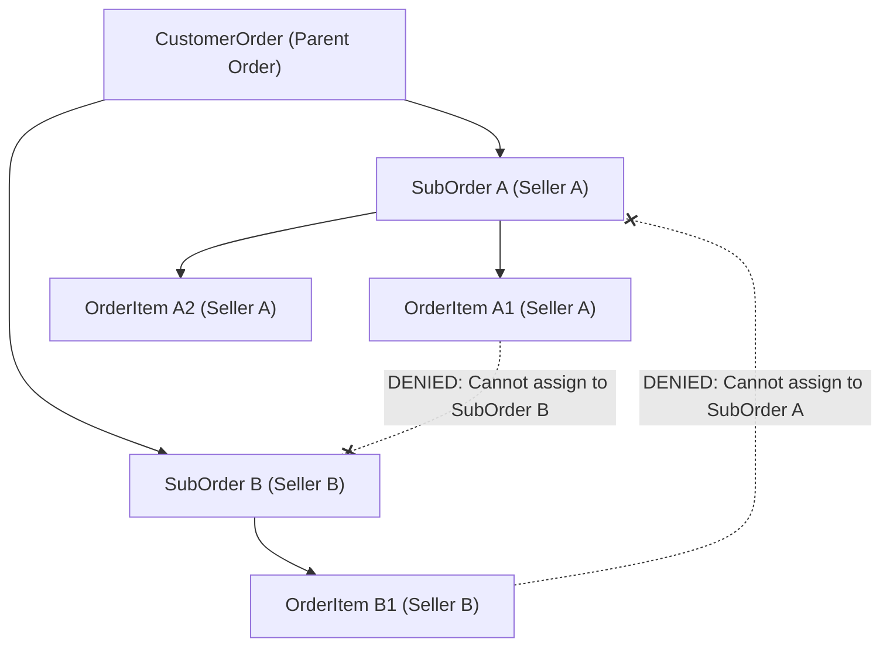

# Data Ownership, Multi-Tenancy & Access Boundaries

**Document Version:** 1.0.0  
**Effective Date:** Gate G03 Baseline  
**Status:** Architecture Policy

---

## 1. Multi-Tenant Philosophy

In our Handcrafted Multi-Vendor platform, artisans are autonomous independent entities operating individual shops. They are NOT internal employees and must NOT have access to cross-tenant operational, catalog, inventory, order, or financial data.

The database enforces multi-tenant boundaries at three layers:

1. **Relational Constraints:** Foreign keys preventing cross-seller linking.
2. **Object-Level ABAC Scoping:** Queries filtered by `seller_id` extracted from authenticated context.
3. **Audit Immutability:** Privileged administrative access recorded in `audit_logs`.

---

## 2. Seller Isolation Invariants



### 2.1 Composite Key Enforcement

To eliminate accidental or malicious cross-seller data tampering, the database utilizes a composite unique constraint on `sub_orders`:

```sql
ALTER TABLE "sub_orders" ADD CONSTRAINT "uq_sub_orders_id_seller" UNIQUE ("id", "seller_id");
```

Every line item in `order_items` must satisfy a composite foreign key:

```sql
ALTER TABLE "order_items"
  ADD CONSTRAINT "fk_order_items_sub_order_seller"
  FOREIGN KEY ("sub_order_id", "seller_id")
  REFERENCES "sub_orders" ("id", "seller_id")
  ON DELETE CASCADE;
```

**Guarantee:** It is impossible for an API route or rogue SQL query to insert an `order_item` belonging to Artisan B into a `sub_order` fulfilling Artisan A's orders. The PostgreSQL relational engine rejects the operation with a foreign key violation (`fk_order_items_sub_order_seller`).

### 2.2 Catalog and Media Ownership

- Products are bound to `seller_id`.
- Product variants inherit `product_id` which enforces cascade delete and owner validation.
- Media assets reference `product_id` and cannot be reattached to other sellers.

### 2.3 Financial & Payout Isolation

- `seller_balances` has a unique constraint on `seller_id`.
- `payout_accounts` strictly belong to `seller_id`.
- `payout_transactions` disburse solely to verified accounts linked to the respective seller.

---

## 3. Customer Data Protection & PII Isolation

1. **Shipping & Billing Addresses:**
   - Stored as frozen snapshots (`jsonb`) on `customer_orders`.
   - Sellers only receive the customer's delivery name, shipping address, and contact number for their specific `sub_order` parcel fulfillment.
   - Sellers never receive customer billing addresses, payment methods, or purchases from other sellers in the same checkout.
2. **Payment Card & Bank Secrets:**
   - No raw credit card numbers, CVVs, bank passwords, or gateway API keys are stored in the application database.
   - Only tokenized references (`provider_intent_id`, `provider_account_id`, `account_last4`) are persisted.
3. **Customer Reviews:**
   - Customer feedback requires verified purchase (`order_item_id` unique FK constraint). Customers cannot review unpurchased products.

---

## 4. Dual-Approval Protocol for High-Risk Actions

Certain operations present severe financial or legal risks and cannot be executed by a single operator:

| Operation                     | Initiator Role       | Authorizer Role      | Database Invariant                                                             |
| :---------------------------- | :------------------- | :------------------- | :----------------------------------------------------------------------------- |
| **Seller Payout Batch**       | `FINANCE_CONTROLLER` | `SUPER_ADMIN`        | `payout_batches.authorized_by IS NOT NULL` and `authorized_by != initiated_by` |
| **Manual Escrow Release**     | `SUPPORT_AGENT`      | `COMPLIANCE_OFFICER` | Recorded in `audit_logs` with before/after state hash                          |
| **Seller Verification / KYC** | `COMPLIANCE_OFFICER` | `COMPLIANCE_OFFICER` | Requires verified `seller_documents` records                                   |
| **Dispute Resolution**        | `SUPPORT_AGENT`      | `MODERATOR`          | `disputes.resolved_by` references authorized staff user                        |
