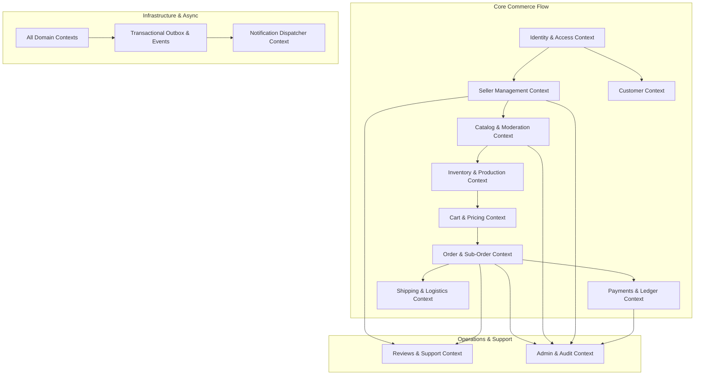

# Domain Boundaries & Bounded Context Specification

**Project:** Handcrafted Multi-Vendor Marketplace  
**Document Version:** 1.0.0  
**Effective Date:** Gate G02 Baseline  
**Architecture Pattern:** Modular Monolith with Explicit Domain Boundaries

---

## 1. Architectural Topology & Context Map

The marketplace backend is structured as a **Modular Monolith** organized into eleven distinct bounded contexts. Each context encapsulates its private domain logic, invariants, and database tables.

Inter-context communication is restricted to:

1. **Public Domain Service Interfaces:** Explicit TypeScript contracts injected via NestJS dependency injection for synchronous, in-transaction read models and transactional coordination.
2. **Asynchronous Domain Events:** Published via the PostgreSQL Transactional Outbox and distributed through Redis/BullMQ.

---

## 2. Bounded Context Specifications

### 2.1 Identity & Access Management (IAM) Context

- **Boundary Responsibility:** User registration, password authentication (Argon2id), session lifecycle, JWT issuance/rotation, role assignments (`CUSTOMER`, `SELLER`, `SUPPORT`, `FINANCE`, `ADMIN`), and permission verification.
- **Owned Tables:** `users`, `user_sessions`, `roles`, `permissions`, `user_roles`.
- **Exposed Interface:** `IIdentityService` (validates credentials, resolves session tokens, checks permissions, retrieves minimal user identity projection).
- **Prohibited:** Storing artisan shop settings, customer shipping addresses, or payment tokens.

### 2.2 Seller & Shop Management Context

- **Boundary Responsibility:** Artisan onboarding, legal verification (KYC), tax identification, private document intake, storefront profiles, craft stories, pickup addresses, and seller status state machines.
- **Owned Tables:** `seller_profiles`, `shops`, `seller_documents`, `pickup_addresses`, `payout_accounts`.
- **Exposed Interface:** `ISellerService` (retrieves seller status, verifies shop operational eligibility, validates pickup coordinates).
- **Prohibited:** Direct handling of catalog items, inventory levels, or raw payment capture.

### 2.3 Catalog & Moderation Context

- **Boundary Responsibility:** Taxonomy categories, product listings, variants, media attachments, handcrafted attributes, craftsmanship disclosures, moderation workflows, and publishing controls.
- **Owned Tables:** `categories`, `products`, `product_variants`, `product_media`, `moderation_records`.
- **Exposed Interface:** `ICatalogService` (reads published listings, validates variant existence and price points, checks moderation clearance).
- **Prohibited:** Mutating inventory quantities or managing cart items.

### 2.4 Inventory & Production Context

- **Boundary Responsibility:** Stock tracking per SKU/variant, atomic reservations with TTL expiration, concurrency locks, made-to-order production queues, and stock adjustment logs.
- **Owned Tables:** `inventory_items`, `inventory_reservations`, `stock_adjustments`.
- **Exposed Interface:** `IInventoryService` (reserves stock atomically, releases reservations, commits stock on order placement).
- **Prohibited:** Computing monetary prices or creating customer invoices.

### 2.5 Cart & Pricing Context

- **Boundary Responsibility:** Cart state management, line-item customization validation, promotional coupon validation, tax estimation, per-seller shipping fee aggregation, and immutable checkout pricing snapshots.
- **Owned Tables:** `carts`, `cart_items`, `promotions`, `coupons`, `pricing_snapshots`.
- **Exposed Interface:** `ICartPricingService` (calculates pricing totals, generates cryptographically signed pricing snapshots for checkout).
- **Prohibited:** Finalizing order placement or debiting financial ledgers.

### 2.6 Order & Sub-Order Orchestration Context

- **Boundary Responsibility:** Parent customer order creation, multi-vendor sub-order decomposition, order status state machines, order item history, and cancellation rules.
- **Owned Tables:** `customer_orders`, `sub_orders`, `order_items`, `order_timeline_events`.
- **Exposed Interface:** `IOrderService` (queries order status, transitions sub-orders through fulfillment states, initiates return workflows).
- **Prohibited:** Communicating directly with external courier APIs or external payment gateways (delegated to Shipping and Payment contexts).

### 2.7 Payments & Financial Ledger Context

- **Boundary Responsibility:** Payment gateway integrations (Stripe, Razorpay), cryptographic webhook processing, idempotency enforcement, double-entry ledger journals, marketplace commission calculation, tax escrow, and seller payout batching.
- **Owned Tables:** `payment_attempts`, `payment_webhook_events`, `ledger_accounts`, `ledger_entries`, `seller_balances`, `payout_batches`.
- **Exposed Interface:** `IPaymentLedgerService` (creates payment intents, processes payment outcomes, authorizes refunds, calculates seller available payouts).
- **Prohibited:** Managing physical shipping logistics or modifying order fulfillment steps.

### 2.8 Shipping & Logistics Context

- **Boundary Responsibility:** Multi-carrier integration (Delhivery, Shiprocket, BlueDart), shipping rate calculation, waybill/AWB generation, label PDF retrieval, tracking milestone ingestion, and return parcel logistics.
- **Owned Tables:** `shipments`, `shipment_milestones`, `return_requests`.
- **Exposed Interface:** `IShippingService` (books shipments, polls tracking updates, ingests courier webhooks).
- **Prohibited:** Directly crediting or debiting seller money balances.

### 2.9 Reviews & Customer Support Context

- **Boundary Responsibility:** Verified-purchase customer reviews, star ratings, artisan replies, support ticketing, customer complaints, and dispute mediation.
- **Owned Tables:** `reviews`, `support_tickets`, `disputes`, `dispute_messages`.
- **Exposed Interface:** `ISupportService` (queries dispute states to trigger financial hold or release).

### 2.10 Administration & Audit Context

- **Boundary Responsibility:** Staff privilege verification, administrative approval queues (seller KYC, high-value refunds, manual payouts), immutable audit logging, and platform operational metrics.
- **Owned Tables:** `audit_logs`, `staff_roles`, `dual_approval_requests`.
- **Exposed Interface:** `IAuditService` (records audit logs for all mutations across the platform).

### 2.11 Notification & Asynchronous Context

- **Boundary Responsibility:** Transactional outbox relay worker, queue orchestration (BullMQ), customer/seller email rendering, SMS notifications, and in-app alerts.
- **Owned Tables:** `outbox_events`, `notification_logs`.

---

## 3. Cross-Boundary Communication & Anti-Corruption Layers (ACL)

1. **Anti-Corruption Layers (ACL) for External Providers:**
   - **Payment Gateway ACL:** Isolates provider-specific objects (e.g., Stripe PaymentIntent, Razorpay Order) behind a unified domain `PaymentProviderPort` producing normalized `PaymentResult` DTOs.
   - **Courier Logistics ACL:** Translates external carrier tracking pushes into normalized platform milestones (`LABEL_CREATED`, `PICKED_UP`, `IN_TRANSIT`, `OUT_FOR_DELIVERY`, `DELIVERED`, `EXCEPTION`, `RTO`).
2. **Zero Cross-Context SQL Joins:**
   - Database queries in the `Order` module must not perform SQL `JOIN`s on `seller_profiles` or `payment_attempts`. Queries retrieve data via module service methods or read-model projections.
3. **Multi-Tenancy Guard Invariant:**
   - Every read and write in seller-scoped domains (`sub_orders`, `seller_balances`, `inventory_items`, `products`) must explicitly include the authenticated seller's identifier:
     $$\text{WHERE seller\_id} = \text{current\_session.seller\_id}$$
