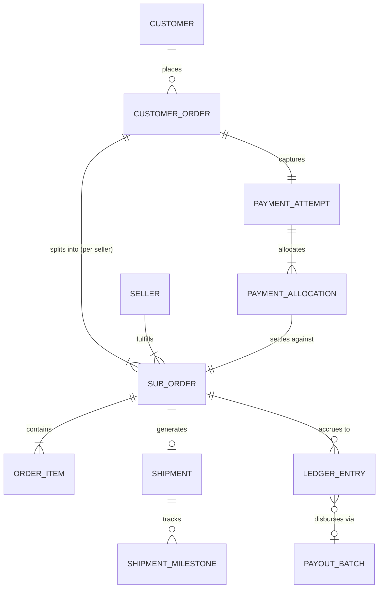

# Domain Model Specification: Handcrafted Multi-Vendor Marketplace

**Document Version:** 1.0.0  
**Effective Date:** Gate G02 Baseline  
**Status:** Canonical Domain Specification

---

## 1. Domain Overview & Conceptual Architecture

The Handcrafted Multi-Vendor Marketplace platform connects independent craftspeople and artisans with discerning customers seeking authentic, handmade physical goods. Unlike mass-manufactured retail platforms, this system models unique artisanal characteristics:

- Variable production lead times for made-to-order creations.
- Single-unit ("one-of-a-kind") inventory constraints.
- Customisation and personalisation specifications.
- Distributed multi-vendor fulfillment origins where a single consumer order is partitioned into autonomous artisan sub-orders.
- Strict double-entry financial ledger accounting for escrow, commissions, taxes, and payouts.

---

## 2. Multi-Vendor Commerce Entity Hierarchy

A core complexity of the marketplace is that a single customer purchase frequently spans multiple independent artisan studios located in disparate geographies.

### Key Relational Rules:

1. **Parent Order vs. Sub-Orders:** The `CustomerOrder` models the customer's legal checkout transaction, total payment, billing address, and overarching payment status. The `SubOrder` models the autonomous fulfillment contract assigned to exactly one `Seller`.
2. **Item Ownership:** Every `OrderItem` belongs strictly to one `SubOrder` and references a specific `ProductVariant`.
3. **Shipment Autonomy:** Each `SubOrder` generates independent `Shipment` entities with distinct waybills, carrier integrations, and tracking numbers.
4. **Financial Decoupling:** Customer payment capture is unified, but payment allocation, platform commission deduction, tax liability, return escrow, and seller payout are tracked per `SubOrder`.

---

## 3. Handcrafted Product Typology & Invariants

Artisanal products exhibit behaviors distinct from standard commoditized e-commerce. The catalog domain defines explicit product types:

| Product Type               | Inventory Behavior                                                              | Lead Time Handling                                                   | Customization Constraints                                               | Return / Cancellation Rules                                                      |
| -------------------------- | ------------------------------------------------------------------------------- | -------------------------------------------------------------------- | ----------------------------------------------------------------------- | -------------------------------------------------------------------------------- |
| **Ready-to-Ship**          | Finite integer inventory balance ($N \ge 1$). Atomic reservation on checkout.   | Fixed handling time (1–2 business days).                             | Standard attributes (color, size) without bespoke input.                | Standard return policy applies (e.g., 7-day return window).                      |
| **One-of-a-Kind (OOAK)**   | Strictly unique ($N = 1$). Auto-archives or marks "Sold" upon payment capture.  | Fixed handling time. Fragile packaging flags common.                 | Zero variant variations; strictly authentic unique art piece.           | Strict return policy; high dispute protection.                                   |
| **Made-to-Order**          | Virtual inventory capacity. Stock represents artisan concurrent build capacity. | Dynamic production lead time (e.g., 7–21 days) before dispatch.      | May require buyer dimensions or specifications.                         | Cancellation permitted only prior to artisan commencing work (`IN_PRODUCTION`).  |
| **Personalized / Bespoke** | Virtual or physical stock with required buyer text/image input.                 | Production lead time applied post-approval of customization details. | Requires validation of buyer customization prompt and character limits. | Non-returnable unless defective or deviating from verified customization prompt. |
| **Fragile / Oversized**    | Standard or OOAK inventory.                                                     | Additional packaging buffer time.                                    | Courier selection restricted to heavy/fragile certified parcel tiers.   | Enhanced insurance and photo-proof requirements upon delivery.                   |

---

## 4. Canonical Entities Dictionary

### 4.1 Identity and Access Domain

- **`User`:** The root identity entity. Contains email, hashed credentials (Argon2id), mobile number, multi-factor authentication (MFA) status, account state (`ACTIVE`, `SUSPENDED`, `DEACTIVATED`), and role memberships.
- **`Session`:** Ephemeral authenticated session instance representing an active refresh token family. Tracks user agent, IP address, creation time, expiration timestamp, and revocation state.
- **`Role` & `Permission`:** Hierarchical authorization primitives governing coarse-grained role-based access control (RBAC) and fine-grained attribute-based access control (ABAC).
- **`IdentityVerification`:** Customer or seller proof-of-identity record tracking external verification checks (email verification tokens, SMS OTP verification).

### 4.2 Seller and Shop Domain

- **`SellerProfile`:** Legal business identity of the artisan. Contains legal name, business registration type (`INDIVIDUAL`, `SOLE_PROPRIETORSHIP`, `REGISTERED_COMPANY`), tax identification number (e.g., GSTIN/PAN/VAT/EIN), verification state (`PENDING`, `UNDER_REVIEW`, `VERIFIED`, `REJECTED`, `SUSPENDED`), and compliance tier.
- **`Shop`:** Public-facing artisan storefront. Contains shop name, slug, brand logo, story/biography, crafting policies, vacation mode toggle, and average review rating.
- **`SellerDocument`:** Secure, private KYC verification file metadata (Government ID, Tax Certificate, Bank Passbook). Stored in private S3 bucket; never publicly readable.
- **`PayoutAccount`:** Bank account or payment-provider linked account details (IBAN/Account Number, IFSC/Routing Code, Beneficiary Name) verified before payout disbursement.
- **`PickupAddress`:** Origin location from which the artisan dispatches packages and courier pickups occur.

### 4.3 Catalog and Moderation Domain

- **`Category`:** Hierarchical taxonomy node (e.g., _Crafts > Pottery & Ceramics > Hand-thrown Vases_). Defines applicable attribute schemas and commission rates.
- **`Product`:** The core listing entity. Defines title, description, category, product type (`READY_TO_SHIP`, `ONE_OF_A_KIND`, `MADE_TO_ORDER`, `PERSONALIZED`), base price (minor units), moderation status (`DRAFT`, `PENDING_REVIEW`, `APPROVED`, `REJECTED`, `SUSPENDED`), and authenticity declarations.
- **`ProductVariant`:** Specific purchasable SKU. Contains variant attributes (e.g., material: Walnut, dimensions: 30x20cm), individual price override, SKU code, weight in grams, packaging dimensions (L x W x H in mm), and inventory tracking mode.
- **`ProductMedia`:** Public image or video asset. Tracks public CDN URL, display order, thumbnail variants, alt text, and moderation screening flag.
- **`ModerationRecord`:** Immutable log of listing reviews conducted by human staff or automated safety filters. Records `moderator_id`, decision (`APPROVED`, `REJECTED`), reason code, and corrective notes.

### 4.4 Inventory and Reservation Domain

- **`InventoryItem`:** Physical on-hand stock or production capacity assigned to a `ProductVariant`.
- **`InventoryReservation`:** Temporary holding lock on stock units during customer checkout. Contains `reservation_id`, `variant_id`, `quantity`, `cart_id` or `checkout_session_id`, `expires_at` (TTL timestamp, standard 15 minutes), and state (`ACTIVE`, `COMMITTED`, `RELEASED`, `EXPIRED`).
- **`StockAdjustment`:** Auditable inventory adjustment entry capturing manual corrections, breakages, stock receipts, or sales reconciliations with actor ID and reason.

### 4.5 Shopping and Pricing Domain

- **`Cart`:** Ephemeral or persistent shopping container associated with an authenticated customer or guest session.
- **`CartItem`:** Line item referencing a `ProductVariant`, requested quantity, selected customization text/options, and timestamp.
- **`PricingSnapshot`:** Immutable calculation breakdown produced at checkout initialization. Details item subtotal, per-seller shipping rates, applicable promotional discounts, calculated sales taxes, and total payable amount.
- **`Promotion` & `Coupon`:** Marketplace-wide or seller-specific discount rules with usage limits, date ranges, minimum order values, and commission absorption rules (marketplace-funded vs. seller-funded).

### 4.6 Orders and Fulfillment Domain

- **`CustomerOrder`:** The parent customer order. Contains `order_id`, `customer_id`, `total_amount_minor`, `currency`, `shipping_address`, `billing_address`, `payment_status` (`PENDING`, `AUTHORIZED`, `PAID`, `FAILED`, `REFUNDED`), `order_status` (`PLACED`, `PROCESSING`, `PARTIALLY_SHIPPED`, `COMPLETED`, `CANCELLED`), and placed timestamp.
- **`SubOrder`:** Seller-specific fulfillment order. Contains `sub_order_id`, `parent_order_id`, `seller_id`, `shop_id`, `subtotal_minor`, `shipping_fee_minor`, `commission_fee_minor`, `tax_minor`, `net_seller_payable_minor`, `status` (`CONFIRMED`, `IN_PRODUCTION`, `READY_FOR_PICKUP`, `SHIPPED`, `DELIVERED`, `COMPLETED`, `CANCELLED`, `RETURNED`).
- **`OrderItem`:** Individual purchased line item containing price snapshot, quantity, artisan customization inputs, and fulfillment status.
- **`OrderTimelineEvent`:** Append-only event history tracking all milestone transitions and actor notes.

### 4.7 Payments and Financial Ledger Domain

- **`PaymentAttempt`:** Intent and transaction record created with external payment gateways (Stripe, Razorpay). Tracks provider reference ID, payment method type, client secret, and status (`INITIATED`, `PROCESSING`, `SUCCEEDED`, `FAILED`, `CANCELLED`).
- **`PaymentWebhookEvent`:** Deduplication and idempotency record storing external event IDs, raw payload hash, processing timestamp, and outcome.
- **`LedgerAccount`:** Double-entry chart of accounts entity (`ASSET:PAYMENT_PROCESSOR`, `LIABILITY:CUSTOMER_ESCROW`, `LIABILITY:SELLER_PAYABLE`, `REVENUE:MARKETPLACE_COMMISSION`, `EXPENSE:GATEWAY_FEES`).
- **`LedgerEntry`:** Immutable append-only journal transaction recording balanced debits and credits:
  $$\sum \text{Debits} == \sum \text{Credits}$$
- **`SellerBalance`:** Read-model projection calculated from ledger entries, partitioned into:
  - `pending_escrow`: Funds held during production and customer return window.
  - `available_payout`: Funds cleared and eligible for bank disbursement.
  - `held_dispute`: Funds frozen due to open customer dispute.
- **`PayoutBatch` & `PayoutTransaction`:** Batch grouping cleared seller payables, generating bank transfers, and reconciling clearing reports.

### 4.8 Shipping and Logistics Domain

- **`Shipment`:** Physical parcel booking generated per `SubOrder`. Contains courier provider code (e.g., Delhivery, Shiprocket, BlueDart), tracking number, waybill/AWB barcode, shipping label PDF URL, parcel dimensions, weight, and status (`LABEL_CREATED`, `PICKUP_SCHEDULED`, `IN_TRANSIT`, `OUT_FOR_DELIVERY`, `DELIVERED`, `RTO_INITIATED`, `RTO_DELIVERED`).
- **`ShipmentMilestone`:** Point-in-time tracking checkpoint ingested from courier webhooks or tracking sync jobs.
- **`ReturnRequest`:** Customer return workflow entity linking order items, customer reason, photo proof, artisan dispute window, return shipping label, and refund authorization.

### 4.9 Reviews and Support Domain

- **`Review`:** Customer evaluation tied to a verified purchase `OrderItem`. Contains star rating (1–5), review text, customer-uploaded photo assets, moderation state, and artisan public reply.
- **`SupportTicket`:** Helpdesk ticket originating from customer or seller. Categorized into order issues, logistics delays, product queries, or payouts.
- **`Dispute`:** Formal claim escalated to marketplace administrators regarding defective handcrafted items, non-delivery, or unauthorized returns.

### 4.10 Administration and Audit Domain

- **`AuditLog`:** Immutable security log recording every privileged administrative action: `actor_id`, `actor_role`, `action`, `resource_type`, `resource_id`, `ip_address`, `before_state_hash`, `after_state_hash`, and timestamp.
- **`OutboxEvent`:** Transactional outbox table storing domain events committed atomically with PostgreSQL database state before asynchronous queue dispatch.
