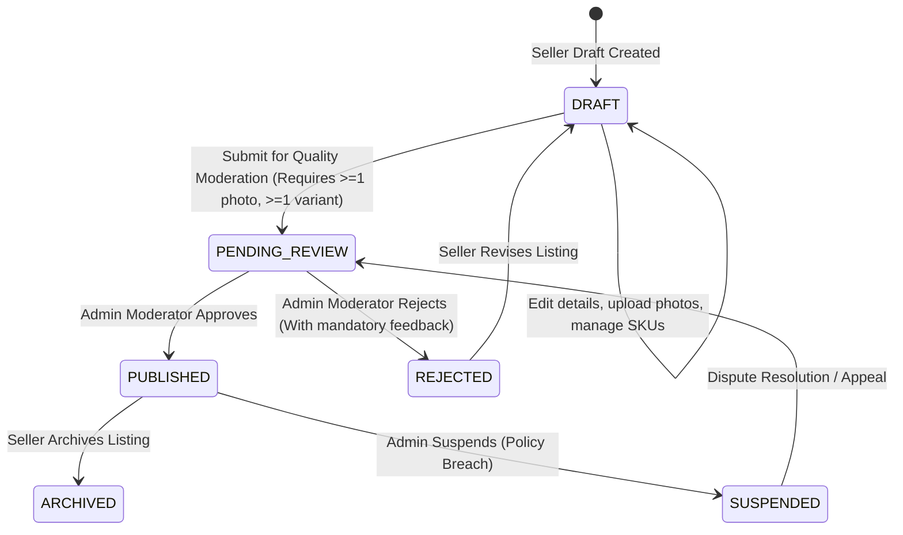
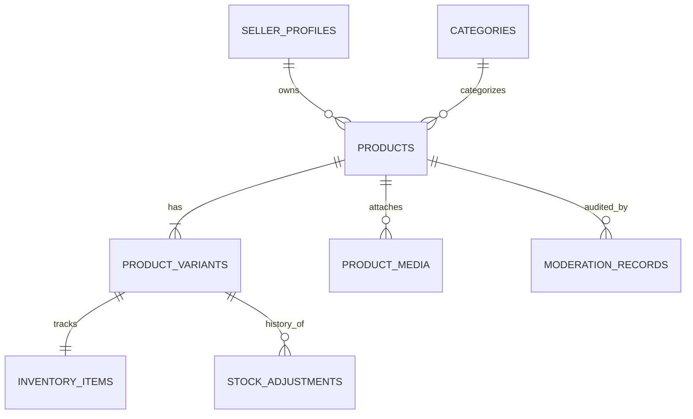

# Product Catalogue, Listing Management & Inventory Architecture

**Project:** Handcrafted Multi-Vendor Marketplace  
**Gate Reference:** G06  
**Status:** Approved & Implemented  
**Classification:** Core Domain Architecture

---

## 1. Domain Overview & Design Philosophy

The product catalogue and inventory domain forms the core operational foundation for the handcrafted marketplace. Unlike mass-manufactured retail platforms, handcrafted items feature distinct operational realities:

- **Artisan Provenance:** Products have distinct materials, techniques, care instructions, and cultural narratives.
- **Made-to-Order & Varied Lead Times:** Production lead times vary from 0 days (ready-to-ship) to weeks (bespoke ceramics, handloom weavings).
- **Fragility & Courier Specs:** Accurate packaging dimensions (mm) and dead weights (g) are mandatory for automated courier rating and volumetric calculations.
- **Strict Seller Eligibility:** Only KYC-verified artisans (`VERIFIED` status via `SellerEligibilityService`) may author listing drafts or submit items for sale.
- **Administrative Moderation:** To protect marketplace integrity against mass-produced commercial drop-shipping, every artisan listing must undergo human moderation before becoming publicly discoverable.

---

## 2. Product Listing Lifecycle State Machine



### State Transitions & Rules

1. **DRAFT:** Private to the owning artisan. Incomplete drafts allowed. Hidden from public discovery.
2. **PENDING_REVIEW:** Queued for quality inspection. Immutable by the seller while pending. Completeness validation guarantees at least one valid photograph and one active variant.
3. **PUBLISHED:** Publicly visible, indexable, and purchasable. Must belong to an active, verified seller.
4. **REJECTED:** Returned to the seller with specific reason codes and actionable feedback notes.
5. **ARCHIVED:** Deactivated by the artisan. Excluded from catalog search and recommendations.
6. **SUSPENDED:** Platform-revoked for policy violation, IP dispute, or mass-production flags.

---

## 3. Data Model & Database Architecture

The domain is implemented with relational integrity in PostgreSQL 16 via Drizzle ORM (`packages/db`):



### Core Schema Invariants

1. **Integer Minor-Unit Pricing (`basePriceMinor`, `priceMinor`):**
   - Prices stored strictly as `bigint` minor units (e.g., ₹890.00 is stored as `89000` paise).
   - Floats and decimals are forbidden in storage to prevent floating-point rounding errors.
   - Enforced by database `CHECK (base_price_minor >= 0)` constraints.

2. **Physical Dimensions & Courier Packaging:**
   - Every product variant records `weightGrams`, `dimensionLengthMm`, `dimensionWidthMm`, and `dimensionHeightMm`.
   - Enforced by database `CHECK (weight_grams > 0 AND length_mm > 0 AND width_mm > 0 AND height_mm > 0)`.

3. **Multi-Tenant Seller Isolation:**
   - Products are bound to `seller_id` (`sellerProfiles.id`).
   - All update, submission, media attachment, and stock adjustment endpoints execute strict tenant ownership checks matching the authenticated session user to the owning seller.

4. **Composite Indexes for High-Traffic Filtering:**
   - `idx_products_seller_status (seller_id, moderation_status)`: Accelerates seller dashboard filters.
   - `idx_products_public_listing (moderation_status, is_active)`: Optimizes public catalog queries filtering only published, active items from verified sellers.

---

## 4. Concurrency-Safe Inventory Management

The `InventoryService` enforces row-level transactional locking using PostgreSQL `SELECT ... FOR UPDATE`:

```typescript
// Transactional concurrency control pattern
await db.transaction(async (tx) => {
  const [item] = await tx
    .select()
    .from(inventoryItems)
    .where(eq(inventoryItems.variantId, variantId))
    .for('update'); // Locks variant row against concurrent writes

  const newOnHand = item.quantityOnHand + delta;

  // Invariant 1: Prevent negative stock on hand
  if (!item.isUnlimited && newOnHand < 0) {
    throw new BadRequestException('Insufficient stock on hand');
  }

  // Invariant 2: Prevent reducing stock below active customer reservations
  if (item.quantityReserved > newOnHand) {
    throw new BadRequestException('Breaches active reservations hold');
  }

  // Update inventory row
  await tx.update(inventoryItems).set({ quantityOnHand: newOnHand }).where(...);

  // Record immutable audit history
  await tx.insert(stockAdjustments).values({ variantId, quantityDelta: delta, reason, ... });
});
```

### Stock Adjustment Reasons

- `RECEIPT`: New kiln batch or workshop receipt.
- `MANUAL_CORRECTION`: Physical audit correction.
- `BREAKAGE`: Workshop transit damage or pottery breakage.
- `SALE_COMMITTED`: Completed customer purchase.
- `RETURN_RESTOCK`: Customer return restocked.
- `AUDIT_DISCREPANCY`: Discrepancy investigation.

---

## 5. Media Security & Direct Storage Uploads

Product images are served via public CDN endpoints while upload authorization is protected:

- **HMAC-Signed Upload Tickets:** Generated via `ProductMediaService.generateUploadTicket(sellerId, input)`.
- **Short-Lived Expiry:** Tickets expire strictly after 15 minutes (900 seconds).
- **Storage Path Isolation:** `public/products/<sellerId>/<randomUUID>.<ext>` ensures non-guessable paths and prevents cross-tenant overwrites.
- **Content Validation:** Strict MIME type whitelist (`image/jpeg`, `image/png`, `image/webp`) and 10 MB maximum file size.

---

## 6. Segregation of Duties in Moderation

To eliminate conflict of interest and prevent fraudulent self-approval:

- Platform staff operators (`SUPER_ADMIN`, `TRUST_SAFETY`, `MARKETPLACE_MANAGER`) who also own an artisan storefront cannot review, approve, or reject listings belonging to their own seller profile (`sellerProfiles.userId !== moderatorId`).
- Every administrative moderation decision inserts an immutable row into `moderation_records` and logs a security audit event in `audit_logs` recording the moderator's identity, action, reason code, and detailed review notes.
