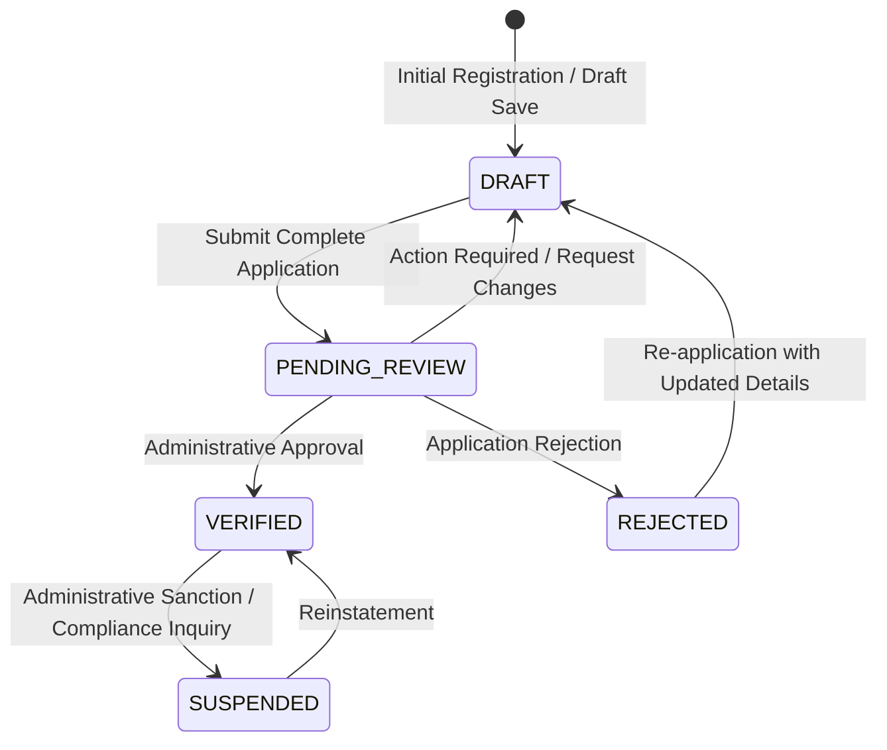

# Seller Onboarding, Verification & Approval Architecture

## 1. Overview and Mission

The Handcrafted Multi-Vendor Marketplace connects independent artisans, craftsmen, and small-batch workshops with customers. To protect the authenticity of legitimate handmade goods (pottery, wooden crafts, canvas paintings, textiles, jewelry, and customized gifts) and protect against counterfeit or mass-manufactured drop-shipping, the platform enforces a **controlled seller lifecycle**.

Registering a customer account never grants permissions to publish products, accept orders, or receive payouts. Instead, sellers must progress through a rigorous, auditable onboarding, KYC document verification, and administrative review process.

---

## 2. Seller Lifecycle State Machine

The seller lifecycle transitions through five distinct verification statuses:



### Lifecycle Status Definitions:

1. **`DRAFT`**: The artisan is assembling legal credentials, shop branding, pickup location, and verification documents. Incomplete fields do not block drafts from saving.
2. **`PENDING_REVIEW`**: The application is complete (all required fields present, shop slug reserved, terms accepted, and at least 1 legitimate KYC document uploaded). The applicant is assigned the `SELLER_APPLICANT` role. The application is locked against further edits.
3. **`VERIFIED`**: Approved by authorized staff (`SUPER_ADMIN`, `TRUST_SAFETY`, `MARKETPLACE_MANAGER`). The applicant is promoted to `APPROVED_SELLER` role, KYC documents are verified, and `SellerEligibilityService` returns `isEligibleToSell: true`.
4. **`REJECTED`**: Application failed verification (e.g. proof of mass-manufacture or unverifiable ID). Detailed reason notes are recorded and visible in the seller dashboard.
5. **`SUSPENDED`**: Platform sanctions applied to an active seller. Immediately restricts product publishing, storefront discoverability, and financial payouts.

---

## 3. Data Architecture and KYC Isolation

### Multi-Tenant Storage Partitioning

KYC verification documents (Government ID, Artisan/Guild Certificates, Tax Registration, Bank Account Settlement Proofs) are sensitive, private data. They are **never** stored in public buckets and **never** served via public CDN URLs.

- Storage Path Convention: `private/sellers/<sellerId>/<documentType>/<uuid>.<ext>`
- Direct Uploads: Granted via time-limited (15-minute) HMAC-SHA256 signed pre-signed upload tickets.
- Inspector Downloads: Staff access is granted exclusively through short-lived (5-minute) HMAC-SHA256 pre-signed download URLs generated on-demand.
- File Constraints: Enforced MIME types (`application/pdf`, `image/jpeg`, `image/png`, `image/webp`) and maximum file size of 10 MB.

### Relational Schema Foundations (`packages/db/src/schema/sellers.ts`)

- `seller_profiles`: User mapping (`userId` unique constraint), legal name, business structure enum (`INDIVIDUAL`, `SOLE_PROPRIETORSHIP`, `REGISTERED_COMPANY`), verification status, compliance tier, terms acceptance audit timestamp and version.
- `shops`: Exactly one shop per seller (`sellerId` unique constraint), globally unique lowercase URL slug, craft story, and branding.
- `pickup_addresses`: Physical workshop/fulfillment address for courier pickup, E.164 phone validation, ISO-3166-1 country code.
- `seller_documents`: Verification documents metadata, multi-tenant storage path, verification status, reviewer notes.

---

## 4. Segregation of Duties and Access Governance

### Segregation of Duties Invariant

To prevent conflicts of interest and fraudulent self-approval:

- **Rule**: An administrative reviewer CANNOT review, approve, or reject their own seller application (`seller.userId !== reviewerId`).
- Enforcement: Verified at the service layer in `SellerReviewService.reviewApplication`. Any attempt throws `BadRequestException` and logs a security event.

### Role Promotion Hierarchy

- `CUSTOMER`: Default registered account.
- `SELLER_APPLICANT`: Assigned automatically upon application submission (`PENDING_REVIEW`).
- `APPROVED_SELLER`: Assigned automatically upon formal approval by authorized reviewers (`VERIFIED`).

---

## 5. Downstream Contracts: `SellerEligibilityService`

Future gates depend on a clean, centralized eligibility contract:

```typescript
export interface SellerEligibility {
  sellerId: string;
  isEligibleToSell: boolean;
  canPublishProducts: boolean;
  canReceivePayouts: boolean;
  verificationStatus: string;
  reason?: string;
}
```

- **Gate G06 (Product Catalog & Inventory)**: Calls `checkSellerEligibility(sellerId).canPublishProducts` before creating product listings or variants.
- **Gate G08 (Orders & Checkout)**: Calls `checkSellerEligibility(sellerId).isEligibleToSell` before allowing items from a seller's shop to be checked out.
- **Gate G09 (Settlements & Payouts)**: Calls `checkSellerEligibility(sellerId).canReceivePayouts` before releasing escrowed funds or scheduling bank transfers.

---

## 6. Audit Trail

Every lifecycle event records an immutable entry into `audit_logs`:

- `SELLER_DRAFT_SAVED`
- `SELLER_DOCUMENT_UPLOAD_REQUESTED`
- `SELLER_DOCUMENT_REMOVED`
- `SELLER_APPLICATION_SUBMITTED`
- `SELLER_APPLICATION_APPROVED`
- `SELLER_APPLICATION_REJECTED`
- `SELLER_APPLICATION_ACTION_REQUIRED`
- `SELLER_SUSPENDED`
- `SELLER_REINSTATED`
