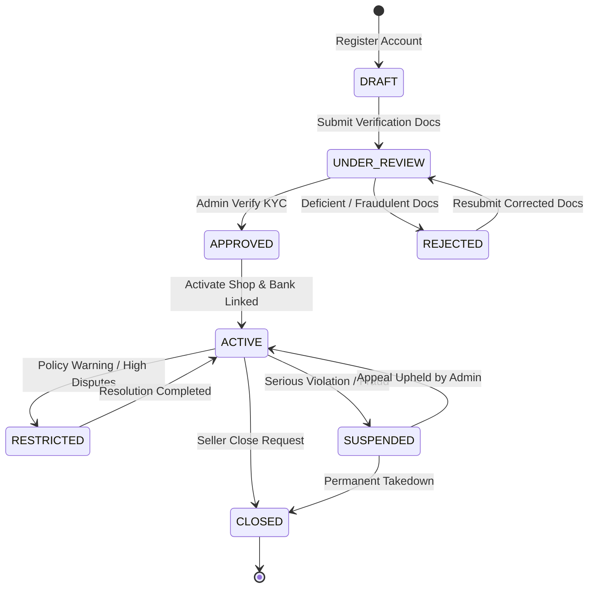
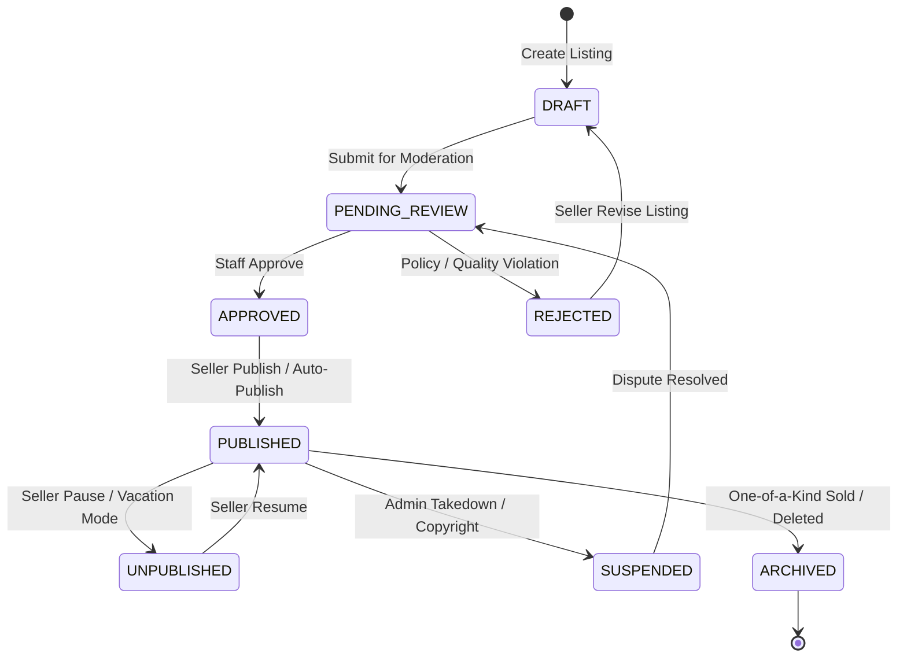
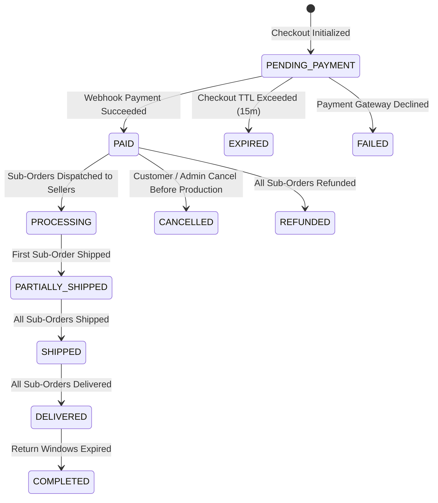
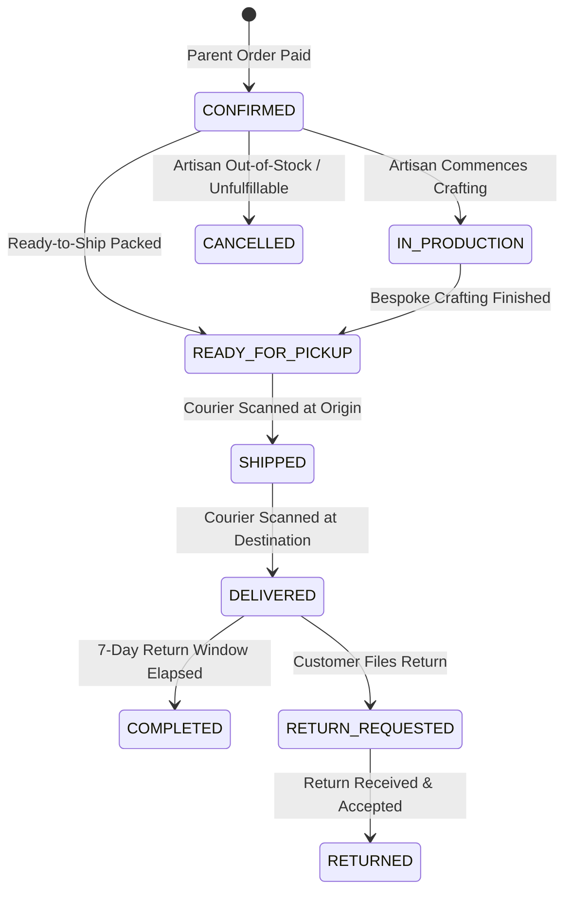
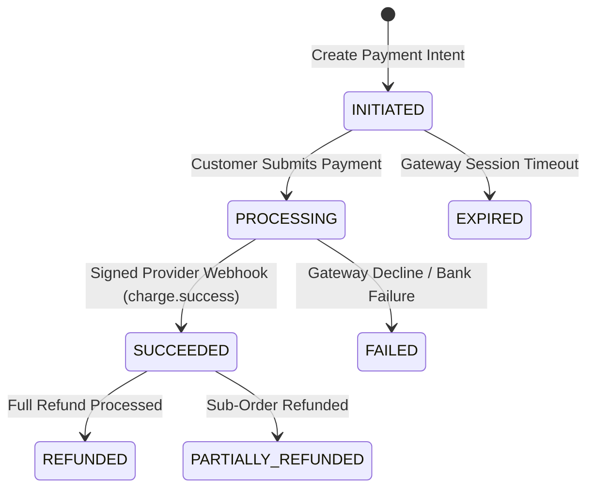
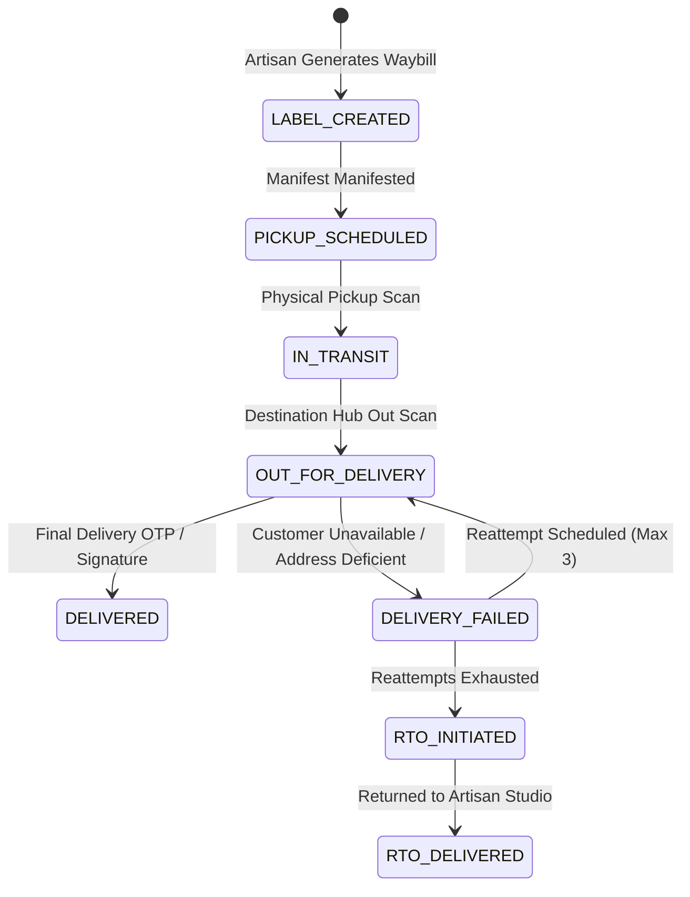
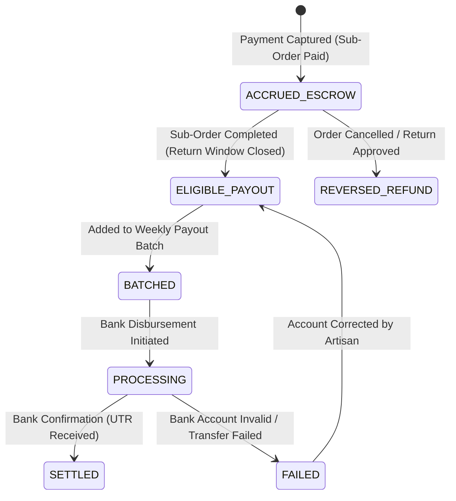

# State Machine Specifications & Transition Rules

**Project:** Handcrafted Multi-Vendor Marketplace  
**Document Version:** 1.0.0  
**Effective Date:** Gate G02 Baseline  
**Rule:** No arbitrary state transitions; all transitions must be strictly validated by domain guards.

---

## 1. Seller Onboarding & Account State Machine

Artisans transition through an auditable identity and compliance verification pipeline.

### Transition Specifications:

| From State     | To State       | Trigger Event      | Authorized Actor         | Guard Conditions                                                     | Side Effects                                                          |
| -------------- | -------------- | ------------------ | ------------------------ | -------------------------------------------------------------------- | --------------------------------------------------------------------- |
| `DRAFT`        | `UNDER_REVIEW` | `seller.submitted` | Seller                   | Tax ID, legal proof, and bank details supplied.                      | Ingest private docs to private S3 bucket; notify compliance queue.    |
| `UNDER_REVIEW` | `APPROVED`     | `seller.approved`  | Compliance Staff / Admin | Background check passed, tax ID verified against government records. | Create public `Shop` record; dispatch welcome email.                  |
| `UNDER_REVIEW` | `REJECTED`     | `seller.rejected`  | Compliance Staff / Admin | Specific rejection reason code provided.                             | Notify seller with remediation checklist; permit resubmission.        |
| `APPROVED`     | `ACTIVE`       | `shop.activated`   | Seller                   | Pickup address configured, shop profile complete.                    | Enable product draft submission and publishing.                       |
| `ACTIVE`       | `SUSPENDED`    | `seller.suspended` | Admin / Safety System    | Fraud threshold breached, dual-approval signed.                      | Delist all active products; freeze available payouts; notify artisan. |

---

## 2. Product Listing & Moderation State Machine

Handcrafted listings require quality and authenticity checks before consumer discovery.

### Transition Specifications:

- **`DRAFT` to `PENDING_REVIEW`:** Guard requires minimum 3 photos, valid category, title, description, material attributes, base price $> 0$, and inventory tracking configuration.
- **`PENDING_REVIEW` to `APPROVED`:** Guard checks for prohibited mass-market reselling items, copyright infringements, or offensive material.
- **`APPROVED` to `PUBLISHED`:** Enables listing in search index and public storefront. If inventory is 0 and product is `READY_TO_SHIP`, auto-renders as "Out of Stock".
- **`PUBLISHED` to `ARCHIVED`:** Triggers when a `ONE_OF_A_KIND` product is purchased and payment captured. Prevents duplicate purchases permanently.

---

## 3. Customer Order & Multi-Vendor Sub-Order State Machine

A single `CustomerOrder` contains one or more independent artisan `SubOrder` records.

### 3.1 Parent Customer Order Lifecycle

### 3.2 Seller Sub-Order Lifecycle

### Sub-Order State Rules:

1. **`CONFIRMED` to `IN_PRODUCTION`:** Applies to `MADE_TO_ORDER` and `PERSONALIZED` goods. Once in production, customer automatic self-service cancellation is disabled.
2. **`READY_FOR_PICKUP` to `SHIPPED`:** Transition is triggered automatically upon courier pickup scan webhook (`PICKED_UP`). Sellers cannot manually mark an order `SHIPPED` without generating an authorized tracking waybill.
3. **`DELIVERED` to `COMPLETED`:** Automated job transitions status after the dispute/return window (7 calendar days post-delivery) expires. This unlocks the funds in the financial ledger from `pending_escrow` to `available_payout`.

---

## 4. Payment Attempt & Webhook Processing State Machine

### Payment Invariants:

- **Zero Client Trust:** A client redirect to a "success" page NEVER marks a payment `SUCCEEDED`. Only a cryptographically verified webhook or verified server-to-server gateway lookup can transition payment to `SUCCEEDED`.
- **Idempotency Guard:** If a webhook with `event_id` is received multiple times, the state machine ignores duplicates and returns HTTP 200 OK without re-executing ledger entries.

---

## 5. Shipment & Logistics State Machine

---

## 6. Financial Ledger & Seller Payout State Machine

