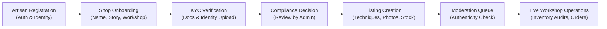
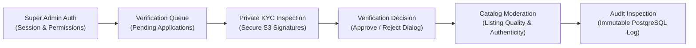

# MASTER UI/UX DESIGN SYSTEM, DESIGN GOVERNANCE & EXPERIENCE BLUEPRINT

**Platform:** Handcrafted Multi-Vendor Marketplace  
**Gate:** G07A (Master UI/UX Design System)  
**Governance Invariant:** One unified design system, three contextual experiences.  
**Compliance Target:** WCAG 2.2 AA accessibility, responsive mobile-first architecture.

---

## 1. Executive Vision & Brand Identity

The handcrafted marketplace connects independent artisans, studio potters, weavers, woodworkers, and jewelers across India with discerning customers seeking authentic, verified craft creations.

### 1.1 Brand Philosophy: "Contemporary Indian Craftsmanship"

The design aesthetic blends heritage artisanal warmth with contemporary digital commerce standards:

- **Warm, not rustic or cluttered:** Clean surfaces, generous editorial whitespace, and refined typography instead of outdated kitsch or simulated parchment textures.
- **Craftsmanship first:** High-fidelity product imagery, provenance storytelling, and artisanal materials are the heroes of every screen.
- **Trust and authenticity:** Prominent verified artisan credentials, transparent provenance disclosures, and rigorous operational tracking without decorative badge clutter.
- **Tactile warmth:** Terracotta clay, warm mustard amber, organic forest dyes, and warm stone surfaces convey material authenticity.

### 1.2 The Three Contextual Application Experiences

| Dimension            | Customer Storefront (`apps/storefront`)             | Seller Studio Portal (`apps/seller-portal`)    | Admin Control Center (`apps/admin-portal`)           |
| :------------------- | :-------------------------------------------------- | :--------------------------------------------- | :--------------------------------------------------- |
| **Primary Persona**  | Conscious shoppers, gift buyers, collectors         | Independent artisans, studio managers          | Trust & safety, catalog moderators, super admins     |
| **Design Character** | Expressive, editorial, warm, discovery-focused      | Operational, streamlined, reassuring, clear    | High-density, structured, cautious, decision-focused |
| **Canvas Palette**   | Warm Stone Canvas (`stone-50` / `#FAFAF9`)          | Studio Workbench (`stone-100` / `#F5F5F4`)     | Control Slate (`stone-900` & `stone-950`)            |
| **Accent Priority**  | Warm Amber CTA (`#D97706`), Terracotta Brand        | Amber operational highlights, Emerald verified | Emerald approve, Rose reject/audit, Amber warn       |
| **Layout Density**   | Generous breathing room, large imagery              | Balanced card and form layouts                 | Dense, compact tables and audit panels               |
| **Touch Targets**    | Mobile-first $\ge 44\times 44\text{px}$ touch zones | Optimized for desktop & tablet workshop entry  | Desktop keyboard shortcuts & high-density clicks     |

---

## 2. Design Tokens Foundation

All design tokens are codified in `@repo/ui` (`packages/ui/src/tokens/`) and exposed via:

1. TypeScript typed exports (`colors`, `typography`, `spacing`, `radii`, `elevation`, `breakpoints`, `motion`).
2. CSS Custom Properties in `packages/ui/src/tokens/theme.css`.
3. Shared Tailwind CSS preset in `packages/ui/src/tailwind-preset.ts`.

### 2.1 Color System

#### Brand Primary: Terracotta / Clay

Reflects wheel-thrown pottery, earthenware, and terracotta temple relief art.

| Token                  | Hex Value | CSS Variable                   | WCAG Contrast on White | Primary Application                       |
| :--------------------- | :-------- | :----------------------------- | :--------------------- | :---------------------------------------- |
| `brand-terracotta-50`  | `#FDF6F4` | `--color-brand-terracotta-50`  | 1.05:1                 | Subtle warm tint background               |
| `brand-terracotta-100` | `#FAECE8` | `--color-brand-terracotta-100` | 1.15:1                 | Artisan highlight card background         |
| `brand-terracotta-200` | `#F4D6CE` | `--color-brand-terracotta-200` | 1.45:1                 | Decorative craft border                   |
| `brand-terracotta-500` | `#C25E3E` | `--color-brand-terracotta-500` | **4.68:1 (AA)**        | Primary artisan brand mark, craft headers |
| `brand-terracotta-700` | `#8E3F27` | `--color-brand-terracotta-700` | **8.12:1 (AAA)**       | Eyebrow text, high-contrast labels        |
| `brand-terracotta-900` | `#5E2D20` | `--color-brand-terracotta-900` | **13.41:1 (AAA)**      | Deep terracotta text, footers             |

#### Brand Secondary: Warm Amber / Mustard Seed

Reflects brass metalwork, turmeric dyes, and cheerful handcrafted commerce actions.

| Token             | Hex Value | CSS Variable              | WCAG Contrast on White | Primary Application                         |
| :---------------- | :-------- | :------------------------ | :--------------------- | :------------------------------------------ |
| `brand-amber-50`  | `#FFFBEB` | `--color-brand-amber-50`  | 1.04:1                 | Warning banner surface, card tint           |
| `brand-amber-100` | `#FEF3C7` | `--color-brand-amber-100` | 1.12:1                 | Craft badge background                      |
| `brand-amber-200` | `#FDE68A` | `--color-brand-amber-200` | 1.34:1                 | Amber border subtle                         |
| `brand-amber-500` | `#F59E0B` | `--color-brand-amber-500` | 2.15:1                 | Focus indicator rings                       |
| `brand-amber-600` | `#D97706` | `--color-brand-amber-600` | **4.55:1 (AA)**        | Primary Storefront CTA Button, active links |
| `brand-amber-800` | `#92400E` | `--color-brand-amber-800` | **7.51:1 (AAA)**       | Amber badge text, price emphasis            |

#### Brand Accent: Forest Emerald

Reflects plant-based natural dyes, jade stones, and authentic verified artisan credentials.

| Token               | Hex Value | CSS Variable                | WCAG Contrast on White | Primary Application                    |
| :------------------ | :-------- | :-------------------------- | :--------------------- | :------------------------------------- |
| `brand-emerald-50`  | `#ECFDF5` | `--color-brand-emerald-50`  | 1.05:1                 | Success banner, verified badge bg      |
| `brand-emerald-100` | `#D1FAE5` | `--color-brand-emerald-100` | 1.18:1                 | Light verified badge pill              |
| `brand-emerald-500` | `#10B981` | `--color-brand-emerald-500` | 2.45:1                 | Active status pulse dot                |
| `brand-emerald-600` | `#059669` | `--color-brand-emerald-600` | **4.52:1 (AA)**        | Verified artisan check, in-stock badge |
| `brand-emerald-800` | `#065F46` | `--color-brand-emerald-800` | **8.20:1 (AAA)**       | Verified status text, success text     |

#### Neutral Stone Palette (Warm Slate)

Replaces harsh cold greys with soothing mineral stone undertones.

| Token       | Hex Value | Usage                                                       |
| :---------- | :-------- | :---------------------------------------------------------- |
| `stone-50`  | `#FAFAF9` | Storefront main page background (canvas)                    |
| `stone-100` | `#F5F5F4` | Seller portal page background, card surfaces, table headers |
| `stone-200` | `#E7E5E4` | Component borders, card outlines, table dividers            |
| `stone-300` | `#D6D3D1` | Input outlines, active borders                              |
| `stone-400` | `#A8A29E` | Muted text, empty state icons, input placeholders           |
| `stone-500` | `#78716C` | Secondary helper text, timestamp labels                     |
| `stone-600` | `#57534E` | Body copy secondary                                         |
| `stone-700` | `#44403C` | Body copy primary, table cells                              |
| `stone-800` | `#292524` | Primary headings, dark buttons hover                        |
| `stone-900` | `#1C1917` | Primary dark headings, admin portal canvas                  |
| `stone-950` | `#0C0A09` | High-contrast admin header, modal backdrops                 |

---

### 2.2 Typography Scale

The typographic scale uses modern sans-serif fonts (`Inter`, system fallbacks) for maximum screen legibility, paired with strict vertical metrics based on a 4px baseline rhythm.

```
Display 5xl: 48px / lh 1.15  (Editorial Landing Hero Headlines)
Display 4xl: 36px / lh 40px  (Product Detail Page Titles)
Display 3xl: 30px / lh 36px  (Section Headlines, Category Landing)
Heading 2xl: 24px / lh 32px  (Card Titles, Modal Headings, Drawer Titles)
Heading xl:  20px / lh 28px  (Sub-section Headings, Table Section Headers)
Heading lg:  18px / lh 28px  (Featured Callout Titles, Summary Rows)
Body base:   16px / lh 24px  (Primary Storefront Body, Product Descriptions)
Body sm:     14px / lh 20px  (Standard Form Inputs, Table Cells, Seller Portal Body)
Caption xs:  12px / lh 16px  (Badges, Helper Text, Form Labels, Table Headers)
Micro:       10px / lh 14px  (Breadcrumbs, Status Pills, Category Eyebrows)
```

**Numeric and Financial Typography:** All currency values (₹ INR paise conversions), SKU identifiers, and inventory quantities use tabular numerals (`font-mono` / `tabular-nums`) to prevent horizontal shifting during cart updates or sort operations.

---

### 2.3 Spacing & Layout Architecture

- **Baseline Grid:** Strict 4px increments ($2\text{px}, 4\text{px}, 8\text{px}, 12\text{px}, 16\text{px}, 24\text{px}, 32\text{px}, 48\text{px}, 64\text{px}$).
- **Container Sizing:**
  - `sm`: 640px (checkout flows, password reset, login cards)
  - `md`: 768px (article views, seller onboarding steps)
  - `lg`: 1024px (seller dashboard, moderation queues)
  - `xl`: 1280px (standard customer storefront max-w-7xl)
- **Responsive Breakpoints:**
  - `sm`: $640\text{px}$ (Mobile landscape / large phones)
  - `md`: $768\text{px}$ (Tablets / split views)
  - `lg`: $1024\text{px}$ (Desktops / sidebars)
  - `xl`: $1280\text{px}$ (Wide desktop monitors)
  - `2xl`: $1536\text{px}$ (Ultra-wide studio monitors)

---

### 2.4 Elevation, Radii & Motion

- **Border Radii:**
  - `sm` ($4\text{px}$): Status badges, small action chips.
  - `md` ($6\text{px}$): Form inputs, standard buttons.
  - `lg` ($8\text{px}$): Content cards, alert banners.
  - `xl` ($12\text{px}$): Modals, dialogs, product gallery hero.
  - `full` ($9999\text{px}$): Circular buttons, pill badges.
- **Elevation Shadows:**
  - `shadow-sm`: Subtle border lift for form controls and compact cards.
  - `shadow-md`: Content cards on hover and dropdown panels.
  - `shadow-lg`: Modals, mobile navigation drawers, and floating cart sheets.
  - `shadow-craft`: Artisan card ambient elevation with warm terracotta undertone (`0 12px 24px -4px rgba(194, 94, 62, 0.08)`).
- **Motion & Accessibility:**
  - Standard transition timing: $150\text{ms}$ for buttons, $200\text{ms}$ for modals.
  - Reduced Motion Invariant: `@media (prefers-reduced-motion: reduce)` resets all transitions and animations to $0.01\text{ms}$ globally.

---

## 3. Shared Component Library Inventory

All components live in `@repo/ui` and provide complete interactive states.

### 3.1 Component Matrix & State Coverage

| Component         |  Default  |      Hover      |  Focus-Visible   | Active / Pressed |     Disabled     |    Loading     |     Error / Empty      |
| :---------------- | :-------: | :-------------: | :--------------: | :--------------: | :--------------: | :------------: | :--------------------: |
| `Button`          |     ✓     |        ✓        | ✓ (ring-2 amber) |   ✓ (scale-98)   |  ✓ (opacity-50)  | ✓ (inline SVG) |           —            |
| `IconButton`      |     ✓     |        ✓        |        ✓         |        ✓         |        ✓         |       —        |           —            |
| `Badge`           |     ✓     |        —        |        —         |        —         |        —         |       —        |     withDot pulse      |
| `Card`            |     ✓     | ✓ (interactive) |        —         |        —         |        —         |       —        |    artisan variant     |
| `FormField`       |     ✓     |        —        |        —         |        —         |        —         |       —        | errorText role="alert" |
| `Input`           |     ✓     |        ✓        | ✓ (ring-2 amber) |        —         | ✓ (bg-stone-100) |       —        |  aria-invalid="true"   |
| `Textarea`        |     ✓     |        ✓        | ✓ (ring-2 amber) |        —         |        ✓         |       —        |  aria-invalid="true"   |
| `Select`          |     ✓     |        ✓        | ✓ (ring-2 amber) |        —         |        ✓         |       —        |      custom arrow      |
| `Checkbox`        |     ✓     |        ✓        |        ✓         |        —         |        ✓         |       —        |   label association    |
| `Modal`           |     ✓     |        —        |   ESC key trap   |        —         |        —         |       —        |     backdrop blur      |
| `ConfirmDialog`   |     ✓     |        ✓        |        ✓         |        —         |        ✓         |       ✓        |  destructive styling   |
| `Table`           |     ✓     |  ✓ (row hover)  |        —         |        —         |        —         |       —        |      dense option      |
| `Pagination`      |     ✓     |        ✓        |        ✓         |        —         |    ✓ (bounds)    |       —        |   page bounds clamp    |
| `Breadcrumb`      |     ✓     |        ✓        |        ✓         |        —         |        —         |       —        |  aria-current="page"   |
| `EmptyState`      |     ✓     |        —        |        —         |        —         |        —         |       —        |   icon + action CTA    |
| `ErrorState`      |     ✓     |        —        |        —         |        —         |        —         |       —        |  role="alert" + retry  |
| `Alert`           |     ✓     |        —        |        —         |        —         |        —         |       —        |    4 semantic types    |
| `StatusIndicator` |     ✓     |        —        |        —         |        —         |        —         |       —        |   9 lifecycle states   |
| `Skeleton`        | ✓ (pulse) |        —        |        —         |        —         |        —         |       —        |   text, rect, circle   |
| `LoadingSpinner`  | ✓ (spin)  |        —        |        —         |        —         |        —         |       —        |     sr-only label      |

---

## 4. End-to-End User Experience Journeys

### 4.1 Customer Storefront Shopping Journey

```mermaid
flowchart LR
    A["Discovery\n(Homepage / Category)"] --> B["Search & Filter\n(Craft Type / Sort)"]
    B --> C["Product Detail (PDP)\n(Gallery / Provenance)"]
    C --> D["Edition Selection\n(Variant / Quantity)"]
    D --> E["Cart Inspection\n(Artisan Partitioning)"]
    E --> F["Delivery Address\n(PIN & Phone Validated)"]
    F --> G["Authoritative Quote\n(Server Pricing in Paise)"]
    G --> H["Reservation Hold\n(15-min Concurrency Hold)"]
    H --> I["Order Placement\n(Placed, Pending Payment)"]
```



1. **Discovery & Browsing:**
   - **Entry Point:** Homepage (`/`) or Category directory (`/categories`).
   - **User Goal:** Explore authentic handcrafted pottery, paintings, woodcraft, jewellery, and textiles.
   - **Key Interactions:** Hero carousel, artisanal discipline chips, craft badges (`READY_TO_SHIP`, `ONE_OF_A_KIND`).
   - **Responsive Behavior:** 4-column grid on desktop, 2-column on tablet, single or 2-column compact on mobile.

2. **Product Detail Inspection (PDP):**
   - **Entry Point:** Product URL (`/products/[slug]`).
   - **User Goal:** Verify artisan provenance, craft techniques, materials, dimensions, and select edition.
   - **Key Interactions:** Multi-thumbnail gallery, variant picker with real-time stock feedback, artisan bio card.
   - **Error Handling:** Out-of-stock disablement, craft customization character limits (500 chars).

3. **Cart & Multi-Artisan Partitioning:**
   - **Entry Point:** Cart page (`/cart`) or sticky header cart badge.
   - **User Goal:** Review selected items, adjust quantities, verify shipping grouped per artisan workshop.
   - **Key Interactions:** Live quantity counters (capped at 50 units), item removal, free shipping thresholds (₹1,000 per artisan).

4. **Checkout & Order Creation:**
   - **Entry Point:** Checkout page (`/checkout`).
   - **User Goal:** Enter Indian delivery address, select shipping, receive authoritative paise quote, confirm order.
   - **Validation Rules:** 6-digit Indian PIN code (`/^[1-9][0-9]{5}$/`), 10-digit phone (`/^[6789]\d{9}$/`).
   - **Safety Invariant:** Inventory hold expires in 15 minutes. Final order status is `orderStatus: 'PLACED'` and `paymentStatus: 'PENDING'`.

---

### 4.2 Seller Studio Journey



1. **Studio Registration & Onboarding:**
   - **Entry Point:** Seller Portal (`/onboarding`).
   - **User Goal:** Establish artisan identity, workshop story, pickup address, and craft specializations.
   - **States:** Step-by-step wizard with persistent draft state and document upload progress indicators.

2. **Listing Management & Inventory:**
   - **Entry Point:** Seller Catalogue (`/products`).
   - **User Goal:** Maintain handcrafted products, track available inventory, record kiln batch receipts or workshop breakage.
   - **Key Interactions:** Search toolbar, status filter tabs (`ALL`, `PUBLISHED`, `PENDING_REVIEW`, `DRAFT`, `REJECTED`), inline stock adjustment modal with audit reason codes.

---

### 4.3 Admin & Compliance Journey



1. **Seller Verification Workspace:**
   - **Entry Point:** Admin Portal (`/sellers`).
   - **User Goal:** Verify artisan legitimacy, inspect authorized KYC documents, protect marketplace authenticity.
   - **Key Interactions:** Multi-status queue, secure document preview links, confirmation dialogs with required rejection notes.

2. **Catalog Moderation:**
   - **Entry Point:** Admin Portal (`/moderation`).
   - **User Goal:** Review handcrafted listings before public publication, check material disclosures and fragile handling requirements.
   - **Safety Invariant:** High-contrast decision controls; destructive actions require explicit modal confirmation.

---

## 5. Comprehensive Screen Specifications

### 5.1 Customer Storefront (14 Screen Specifications)

1. **Homepage (`/`):**
   - **Hero Section:** Editorial showcase highlighting verified master potters and weavers.
   - **Artisanal Disciplines Grid:** 6 curated craft cards (Pottery, Painting, Woodcraft, Jewellery, Textiles, Gifts).
   - **Newest Creations Feed:** Live catalog query (`/catalog/products?sort=newest&limit=8`).
   - **Artisan Workshop Spotlight:** Editorial interview with high-resolution photography.
2. **Category Directory (`/categories`):**
   - Comprehensive alphabetical directory of craft categories with artisan workshop count.
3. **Category Listing (`/categories/[slug]`):**
   - Breadcrumb navigation, sort toolbar (`newest`, `price_asc`, `price_desc`), craft type filter chips, pagination.
4. **Search Results (`/search`):**
   - Query refinement toolbar, active query pills, result counter, friendly empty search state with query suggestions.
5. **Product Detail Page (`/products/[slug]`):**
   - Two-column layout on desktop: Left column multi-image gallery (`ProductGallery`), Right column product title, artisan badge, price in INR, variant selector, and Add to Cart CTA.
   - Bottom accordion: Craft techniques, materials, dimensions, weight, and care instructions.
6. **Product Gallery:**
   - Main high-resolution viewport with thumbnail strip and placeholder fallback for missing images.
7. **Variant & Edition Selector:**
   - Pill selectors for sizes, colors, and editions with real-time stock availability and custom note input.
8. **Shopping Cart (`/cart`):**
   - Line items grouped by artisan workshop. Quantity stepper buttons, unit price in INR, free shipping meter, and Proceed to Checkout button.
9. **Checkout Flow (`/checkout`):**
   - Multi-step form: Saved delivery address picker, new address form with Indian PIN validation, coupon code input, pricing breakdown table.
10. **Delivery Address Entry:**
    - Recipient name, 10-digit Indian mobile number, Street lines, City, State, 6-digit PIN code.
11. **Shipping Selection:**
    - Standard artisan dispatch vs express studio shipping option cards with delivery estimates.
12. **Order Confirmation (`/checkout/success`):**
    - Order number hero, `orderStatus: PLACED`, `paymentStatus: PENDING`, sub-order summary per artisan workshop.
13. **Customer Authentication Entry:**
    - Clean login/registration modal with email/password and MFA support.
14. **404 Not Found & Unavailable Listing (`/not-found`):**
    - Empathetic error state explaining that the handcrafted piece may have been purchased or archived, with a button to return to catalog.

### 5.2 Seller Studio Portal (6 Screen Specifications)

1. **Studio Overview (`/`):**
   - Summary statistics cards: Active listings, pending reviews, stock alerts, studio verification status pill.
2. **Onboarding Wizard (`/onboarding`):**
   - 4-step progressive disclosure: Shop Profile → Workshop Details → KYC Documents → Verification Submission.
3. **Product Catalogue (`/products`):**
   - Searchable, filterable table with thumbnail, title, craft type badge, price in INR, on-hand stock, and action buttons.
4. **New Listing Creation (`/products/new`):**
   - Comprehensive craft listing form: Title, category, craft discipline, materials, techniques, variant table, price, inventory.
5. **Stock Adjustment Modal:**
   - Accessible modal displaying current stock, adjustment delta counter (+/-), audit reason selector, and commit button.
6. **Shop Profile & Settings:**
   - Artisan bio editor, banner photography upload, pickup address for courier dispatch.

### 5.3 Admin Control Center (5 Screen Specifications)

1. **Operations Overview (`/`):**
   - Metric cards: Pending seller applications, listings awaiting moderation, system security status.
2. **Seller Verification Queue (`/sellers`):**
   - High-density table of artisan applications with legal name, business type, submitted date, document count, and inspect action.
3. **Seller Application Inspection Modal:**
   - Two-pane modal: Left pane artisan details and secure document links; Right pane decision actions (Approve, Request Changes, Reject).
4. **Catalog Moderation Queue (`/moderation`):**
   - Card/table inspection of submitted product listings with craft technique verification and publish/reject decisions.
5. **System Governance & Audit Viewer:**
   - Immutable log view of administrative decisions with operator ID, target resource, action type, and timestamp.

---

## 6. Accessibility & Compliance Standards (WCAG 2.2 AA)

1. **Color Contrast:**
   - Normal text ($\le 18\text{px}$): Minimum $4.5:1$ contrast against background.
   - Large text ($> 18\text{px}$ or bold $> 14\text{px}$): Minimum $3.0:1$ contrast.
   - UI components and graphical objects: Minimum $3.0:1$ against adjacent backgrounds.
   - **No Color Alone:** Every status indicator pairs color with text labels or distinct glyphs (`✓`, `!`, `✕`, `ℹ`).
2. **Keyboard Navigation:**
   - Logical tab order matching visual layout across all screens.
   - Visible focus indicators: 2px offset-2 amber ring (`ring-2 ring-amber-500 ring-offset-2`).
   - Modals trap focus and close on `Escape` key press.
3. **Form Labelling & Errors:**
   - Every input has an associated `<label>` using `htmlFor` and matching `id`.
   - Error messages use `role="alert"` and are connected to inputs via `aria-describedby`.
   - Required fields are programmatically indicated with `aria-required="true"` and visually marked with an asterisk (`*`).
4. **Touch Target Sizing:**
   - Minimum interactive touch target of $44\times 44\text{px}$ on touch devices.
   - Sufficient spacing between adjacent links and action buttons to prevent accidental taps.
5. **Screen Readers:**
   - Image tags contain meaningful `alt` text describing the craft technique and object.
   - Icon buttons enforce mandatory `aria-label` attribute.
   - Live regions (`role="status"`, `role="alert"`) announce dynamic updates such as cart item counts.

---

## 7. Design Governance & Evolution Rules

### 7.1 Rules for Introducing New Components

1. **Search Before Creation:** Always inspect `@repo/ui` before creating a local component in an app.
2. **Abstract After Repetition:** If a component is used across multiple routes or applications, promote it to `packages/ui/src/components/`.
3. **Mandatory State Coverage:** Any new component must handle default, hover, focus, disabled, loading, and error states where applicable.
4. **Zero Untyped Props:** All components must export an explicit TypeScript interface extending standard HTML attributes.
5. **Test Invariant:** Any component added to `@repo/ui` must have corresponding test coverage in `packages/ui/test/`.

### 7.2 Rules for Modifying Design Tokens

1. **No Hardcoded Hex Literals:** Never use arbitrary hex values in application JSX files; always reference `brand-*`, `craft-*`, or `stone-*` tokens.
2. **Backward Compatibility:** Deprecate tokens with fallback mappings rather than abrupt deletions to prevent visual regressions across gates.
3. **Contrast Verification:** Any palette modification must be verified against WCAG 2.2 AA standards before committing.
